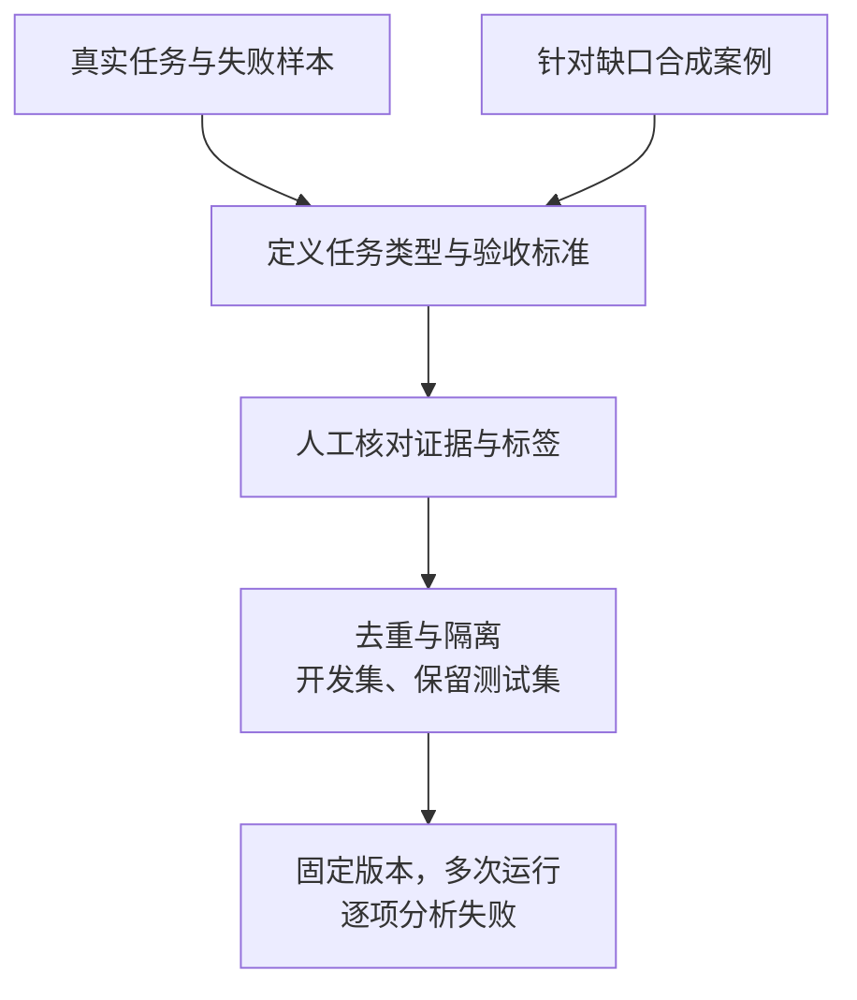

import InterviewQuestion from '../../../../components/InterviewQuestion.astro';

<InterviewQuestion>

从真实任务和已观察到的失败构造评测集，每题保存输入、可用环境、正确证据及验收规则。合成数据用于补足稀缺场景和表达变化，但需要核对答案、覆盖与难度；同一个模型生成并自评，可能把它的共同错误当成正确结果。

## 覆盖要按失败类型设计

除了正常问答，加入没有答案、权限不足、资料冲突、工具失败、多步依赖和表达歧义。检索任务标注正确证据，写操作标注允许的副作用。用场景矩阵检查缺口，不能把同一个问题改写几十遍算成几十种能力。

去重应考虑相同模板、同一文档和相同任务实体；按任务或文档分组隔离，减少训练和调 Prompt 时泄漏。记录数据、知识库、模型、工具和评分器版本；后台状态也应重置到可比较的条件。

### 评测集越大越好吗？

先让关键样本的标签可信、验收明确。持续把新的真实失败加入开发回归集，保留测试集用于独立检验。最终报告分场景结果和多次运行稳定性，不让大量简单题掩盖少数严重错误。

资料

核对于 2026-10-14。[Agent 评测的任务、Grader 与数据维护](https://www.anthropic.com/engineering/demystifying-evals-for-ai-agents)。场景矩阵、分组隔离与版本要求为本站工程建议。

</InterviewQuestion>
