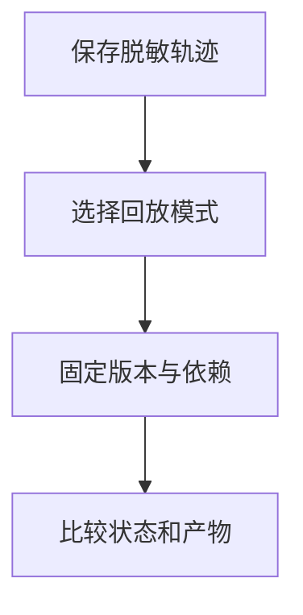

import InterviewQuestion from '../../../../components/InterviewQuestion.astro';

<InterviewQuestion>

轨迹保存模型输入配置、工具调用、工具结果、状态变化和产物，并关联版本与运行标识。回放可以固定工具响应来比较决策，也可以真实重执行；两种模式的结论不同。

## 固定变化来源

工具回放适合隔离 Prompt 或模型变更，但无法验证真实下游的新行为。回放响应应按工具、规范化参数及数据快照匹配；模型换了查询条件，就不能按调用顺序塞入旧结果。未匹配的调用要标明无法回放，或转入受控测试工具。

真实重执行使用隔离环境和测试对象，写操作禁止无审核地重放到生产。记录随机性、知识快照、依赖版本与时限，敏感日志先脱敏。OpenTelemetry 提供轨迹关联能力，不会自动实现上述回放执行器。

### 回放成功是否证明线上也成功？

不能。线上权限、数据、负载和下游响应可能不同。用回放定位差异，再以集成测试和受控线上观察补证据；不把录制的成功返回当成真实执行。

资料

核对于 2026-10-15。[OpenTelemetry Traces](https://opentelemetry.io/docs/concepts/signals/traces/)。

</InterviewQuestion>
