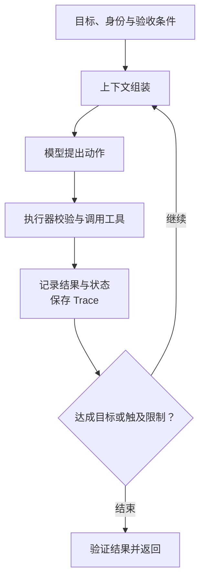

import InterviewQuestion from '../../../../components/InterviewQuestion.astro';

<InterviewQuestion>

Harness 是承载 Agent 执行的运行系统：为模型准备上下文，把它提出的动作交给工具，保存状态，并控制权限、预算和停止条件。模型决定下一步，不等于程序可以直接照做。不同框架对这个词的边界不完全相同，回答时应说明自己的划分。

## 用一条任务说明模块边界

例如“定位构建失败并给出修复建议”：上下文模块读取错误和相关文件；模型选择检查动作；执行器在允许的目录中运行命令；状态模块记录已查内容和产物；验证器检查建议是否有证据。修改文件、安装依赖等动作要服从独立的权限规则。

业务差异可以放进工具、知识、Skills 和验收规则。超时、取消、检查点及审计尽量复用。先让一个完整循环可靠运行，再决定是否需要插件体系；不必为了列齐模块拆成微服务。

### 模型更强，还需要 Harness 吗？

需要。模型能力不会替代数据权限、外部副作用、持久状态和恢复规则。判断改进来自哪里，应固定模型与任务集，比较完成率、错误操作、延迟和成本。

资料

核对于 2026-10-14。[LangGraph 运行能力](https://docs.langchain.com/oss/python/langgraph/overview)、[AgentScope 状态与会话](https://doc.agentscope.io/tutorial/task_state.html)。模块划分与构建任务为本站工程示例。

</InterviewQuestion>
