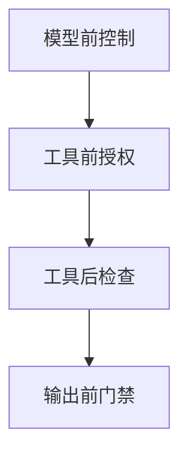

import InterviewQuestion from '../../../../components/InterviewQuestion.astro';

<InterviewQuestion>

Hook 或 Middleware 用于在模型、工具和结果边界插入确定性控制，例如授权、预算、日志和结果检查。名称随框架变化，但控制必须作用在真实执行路径，不能只写在提示词里。

## 检查发生在副作用之前

模型前准备上下文并检查预算，工具前校验身份与输入，工具后记录结果并脱敏，最终回复前检查引用和输出约束。明确 Hook 顺序及失败策略，避免多个插件重复重试同一次写操作。

### Hook 内抛异常应该怎样处理？

安全校验失败应拒绝执行；可选指标采集故障可降级但需告警。框架支持的替换、短路与异步能力不同，应选定版本并验证，而不是假设所有 Hook 都能随意修改状态。

资料

核对于 2026-10-14。[LangChain Middleware](https://docs.langchain.com/oss/python/langchain/middleware/built-in)。正文场景、示例代码与方案取舍为教学示例；具体接口按选定版本核对。

</InterviewQuestion>
