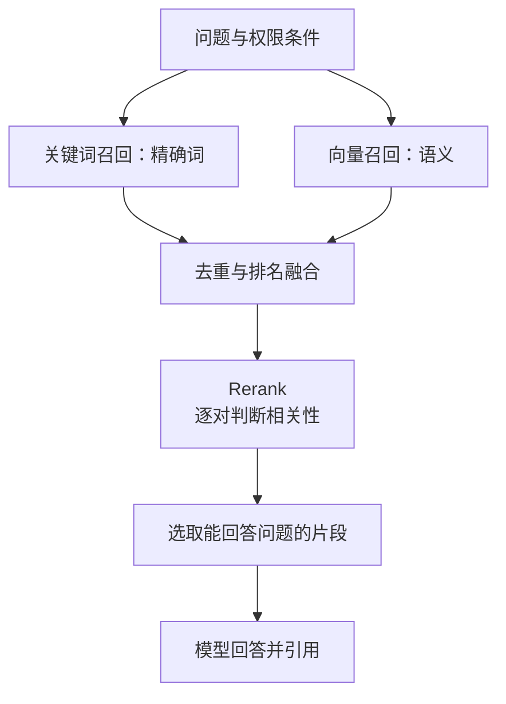

import InterviewQuestion from '../../../../components/InterviewQuestion.astro';

<InterviewQuestion>

向量检索擅长找意思相近的表达，关键词检索擅长找型号、错误码和专有名词。混合检索让两路各找候选，再合并；Rerank 对“问题与候选片段”重新判断相关性，把更可能回答问题的内容排在前面。

例如搜索“X42 网关报 E103 怎么办”，型号和错误码需要精确匹配，问题的口语表达又可能与文档不同。只走一路容易漏掉相关资料。

## 别直接把两路分数相加

BM25 分数和向量相似度的尺度不同，直接相加会让某一路意外占主导。可以先用排名融合，例如 RRF：对每篇文档，累加各路的 `1 / (常数 + 排名)`；没有进入某一路的文档在该路不加分。这样使用名次，避免直接比较异构分数，但仍需用业务评测选择召回量及参数。也可以在明确校准后做分数融合。

候选 TopK 控制进入重排的数量，最终 TopK 控制交给生成模型的数量，两者不是同一个预算。先用有标准答案的查询查召回率，再看排序质量、答案依据和时延。

### Cross-Encoder 为什么适合重排？

双编码器分别把问题和文档变成可缓存的向量，适合快速召回。Cross-Encoder 把问题与候选文档一起输入模型，直接判断这一对是否相关，能利用更细的交互；每个候选都要额外推理，所以通常只重排有限候选。预训练目标未必适合当前业务，仍需对比相关证据排名、最终答案与延迟，不能仅凭模型名称宣称更准确。

### Rerank 能救回没有召回的文档吗？

不能。正确片段没进候选集合，再强的重排模型也看不到它。先检查解析、索引、权限过滤和召回，再调重排。

### 多取一些片段，效果一定更好吗？

不一定。重复、过期或互相冲突的片段会占上下文，还可能误导模型。需要去重、版本处理和权限过滤。相关性分数也不是答案置信度，阈值要用当前检索模型和业务样本校准。

资料

核对于 2026-10-14。[百炼知识检索流程与参数](https://help.aliyun.com/zh/model-studio/rag-knowledge-retrieval)、[AgentScope 检索组件](https://doc.agentscope.io/tutorial/task_rag.html)、[Sentence Transformers Cross-Encoder](https://sbert.net/docs/cross_encoder/usage/usage.html)。型号查询与组合策略为工程示例；RRF 见 [作者发布的原始论文](https://cormack.uwaterloo.ca/cormacksigir09-rrf.pdf)。

</InterviewQuestion>
