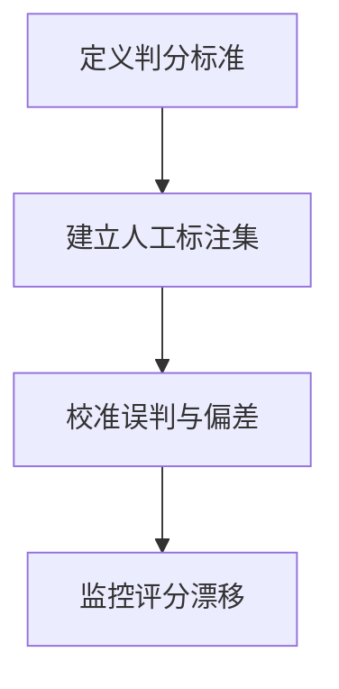

import InterviewQuestion from '../../../../components/InterviewQuestion.astro';

<InterviewQuestion>

模型评分适合补充难以写成规则的质量判断，但必须使用明确 Rubric 和人工标注样本校准。答案顺序、长度、文风和模型来源可能引入偏差，不能把一次分数当作客观真值。

## 让评价器也有测试集

定义事实性、完整性和可执行性等具体标准，尽量引用原始证据。与人工标签比较一致性及各类误判，交换候选答案顺序并多次判分。能用测试、数据库状态或引用匹配判断的部分优先用确定性检查。

### 评分模型与被测模型可以是同一个吗？

可以使用，但错误可能相关，应单独测偏差并引入外部验证。对高影响争议抽样人工复核，记录 Judge 版本；换 Judge 后不能直接比较旧分数。

资料

核对于 2026-10-15。[MT-Bench 与 Chatbot Arena 的 Judge 偏差研究](https://arxiv.org/abs/2306.05685)。Rubric、顺序交换和人工复核为评测设计建议；论文中的一致性结果不保证当前模型或任务达到同样水平。

</InterviewQuestion>
