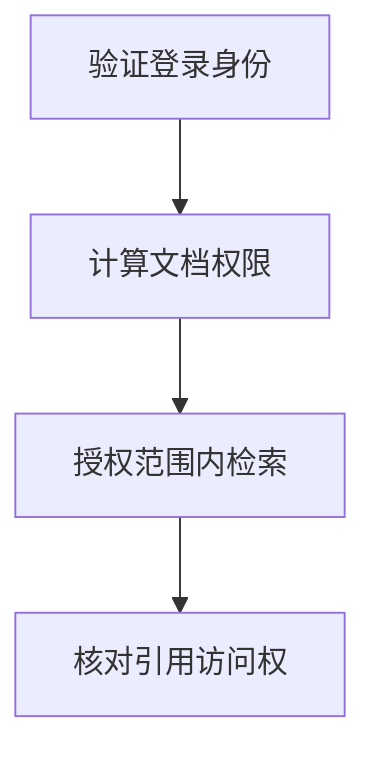

import InterviewQuestion from '../../../../components/InterviewQuestion.astro';

<InterviewQuestion>

检索权限必须由应用的真实登录身份决定，并跟随文档、切片和引用传播。只在生成后过滤答案太晚：未授权内容一旦进入模型上下文，就已经越过边界。

## 所有检索通道执行同一权限约束

查询、向量检索、关键词召回、重排和原文下载都应携带租户及授权范围。缓存键包含权限范围和知识版本；权限变更使缓存失效。多租户用数据库原生过滤或明确分区，并测试空租户、伪造 ID 和共享链接等路径。

### 先取全库 Top-k 再过滤可以吗？

可能导致无权内容暴露给中间组件，而且过滤后召回不足。应尽量在检索阶段执行授权过滤，确需后过滤时也必须在进入模型前完成，并明确性能与召回损失。

资料

核对于 2026-10-14。[MCP Tools 2025-11-25](https://modelcontextprotocol.io/specification/2025-11-25/server/tools)、[LangChain 检索架构](https://docs.langchain.com/oss/python/deepagents/retrieval)。正文场景、示例代码与方案取舍为教学示例；具体接口按选定版本核对。

</InterviewQuestion>
