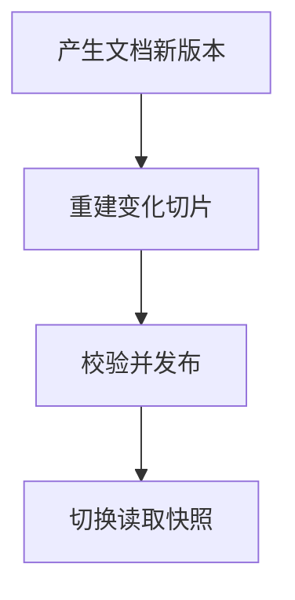

import InterviewQuestion from '../../../../components/InterviewQuestion.astro';

<InterviewQuestion>

知识更新要同时处理原文、切片、向量、关键词索引和缓存。给文档与索引建立版本关系，新版本可检索并通过校验后再切换读取；删除也要使旧切片和缓存失效。

## 读取一份可解释的快照

文档更新产生新版本和内容哈希，只重建变化部分。建立切片所属文档及版本的映射，验证数量、解析质量和权限后发布新索引。一次查询固定读取版本，避免不同召回通道混用版本；工程上可通过版本指针或索引别名切换。

删除记录与当前授权要独立于内容快照校验。回滚索引不能重新放出已删除文档，或恢复已撤销的访问权；旧向量、原文读取、缓存和引用下载都应受同一失效规则约束。

### 知识更新后，旧对话还能引用原答案吗？

旧答案应保留原出处和生成时的版本，继续追问时判断是否需要刷新。涉及价格、权限和政策时重新查当前版本，不能把历史回答当成最新知识。

资料

核对于 2026-10-15。[Elasticsearch 索引别名与切换](https://www.elastic.co/docs/manage-data/data-store/aliases)、[LangChain 检索架构](https://docs.langchain.com/oss/python/deepagents/retrieval)。统一快照、删除拦截和回滚规则为工程设计，不表示所有检索系统都原生提供同样能力。

</InterviewQuestion>
