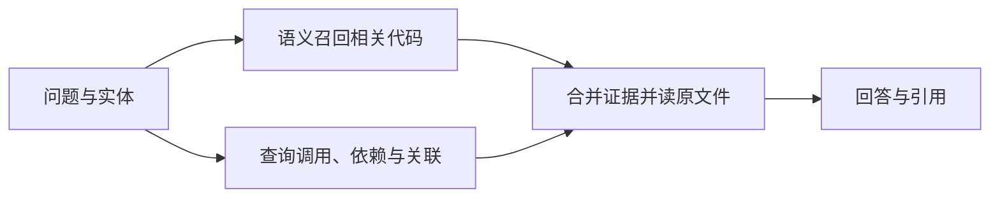

import InterviewQuestion from '../../../../components/InterviewQuestion.astro';

<InterviewQuestion>

知识图谱用实体和关系表达结构；RAG 是先检索外部证据、再辅助生成的方式。图谱可以作为 RAG 的检索来源，二者能组合。普通向量检索擅长找语义相近的文本，关系查询更适合追踪调用、依赖和多跳联系，但需要额外建图和更新成本。

## 代码图先明确关系从哪里来

教学例：“修改函数 A 会影响哪些接口？”需要沿调用边寻找使用者，再读配置和测试。静态分析得到的符号与引用通常比自由生成的关系更可核对，但动态调用、反射和运行时配置仍可能漏掉。

不要把图里的边当作无条件真相：保存代码版本、文件位置和提取方式。代码变化后更新受影响关系；过期图谱可能比没有图谱更容易误导。Microsoft GraphRAG 的文本实体抽取和社区摘要是一种实现，不能代表所有代码图都需要同样流程。

### 怎样证明建图值得？

固定问题集，与文件搜索或向量 RAG 的基线比较，测多跳证据覆盖、答案正确率和耗时，再计入建图与增量维护成本。只在“感觉更懂仓库”上给结论，不能支持技术选型。

资料

核对于 2026-10-14。[Microsoft GraphRAG 官方说明](https://microsoft.github.io/graphrag/)。代码调用图、版本维护及对照方法为本站工程示例。

</InterviewQuestion>
