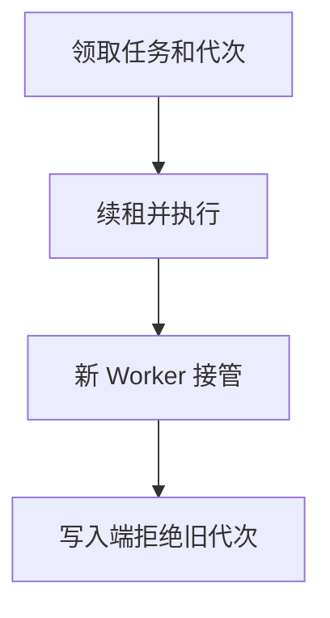

import InterviewQuestion from '../../../../components/InterviewQuestion.astro';

<InterviewQuestion>

租约过期后，新 Worker 可以接管任务，但旧 Worker 可能只是暂停后恢复。仅靠租约不能阻止旧 Worker 继续写；需要递增的 Fencing Token，并由写入端拒绝旧令牌。

## 令牌必须在真正写入处生效

接管时从可靠的协调机制获取更高代次，任务状态和下游写操作携带代次。写入端把令牌检查与业务修改原子完成：验证当前代次，或按协议记录并拒绝小于已接受代次的令牌；不能先检查，再在事务外无条件写入。

幂等键只去重同一次业务操作，不会自动拒绝旧 Worker 发出的另一笔写入，不能替代 Fencing。外部系统不支持令牌校验时，可由具有可靠写入控制的代理统一提交，或限制自动接管并对账；若仍无法隔离旧执行者，就不能承诺不会发生陈旧写入。

### 用了分布式锁就能保证只有一个 Worker 吗？

锁有效期内可以限制进入，但暂停、网络分区和超时会造成陈旧持有者。应说明故障假设、令牌生成与接收端校验；不能声称锁自动提供全链路恰好一次。

资料

核对于 2026-10-15。[分布式锁与 Fencing](https://martin.kleppmann.com/2016/02/08/how-to-do-distributed-locking.html)。

</InterviewQuestion>
