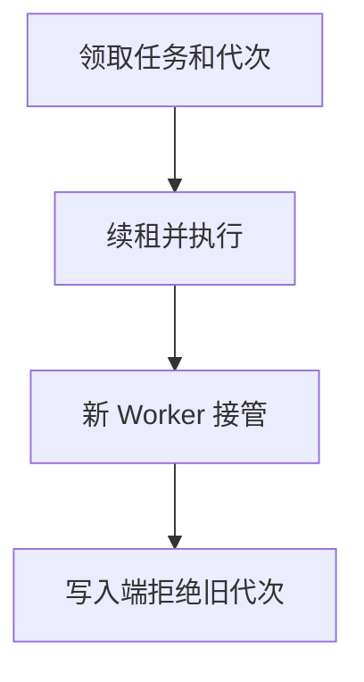

import InterviewQuestion from '../../../../components/InterviewQuestion.astro';

<InterviewQuestion>

租约过期后，新 Worker 可以接管任务，但旧 Worker 可能只是暂停后恢复。仅靠租约不能阻止旧 Worker 继续写；需要递增的 Fencing Token，并由写入端拒绝旧令牌。

## 令牌必须在真正写入处生效

接管时从可靠的协调机制获取更高代次，任务状态和下游写操作携带代次。数据库用条件更新验证当前代次，外部系统若不支持 Fencing 则另用幂等键、单写代理或对账。心跳续租是活性机制，不能替代写入校验。

### 用了分布式锁就能保证只有一个 Worker 吗？

锁有效期内可以限制进入，但暂停、网络分区和超时会造成陈旧持有者。应说明故障假设、令牌生成与接收端校验；不能声称锁自动提供全链路恰好一次。

资料

核对于 2026-10-14。[分布式锁与 Fencing](https://martin.kleppmann.com/2016/02/08/how-to-do-distributed-locking.html)。正文场景、示例代码与方案取舍为教学示例；具体接口按选定版本核对。

</InterviewQuestion>
