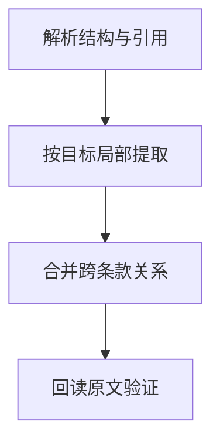

import InterviewQuestion from '../../../../components/InterviewQuestion.astro';

<InterviewQuestion>

长文档分析先建立章节、条款和引用关系，再按审查目标分块提取。局部结果回到全局规则汇总，关键结论回读原文；一次压缩整份合同容易丢失例外和跨章节条件。

## 局部提取与全局判断分开

切片保存页码、条款编号和父章节。每个子任务提取指定事实及原文位置，不自行判断所有风险。汇总阶段对照术语定义、附件、修订版本和冲突条款，计算覆盖率并检查未解析页面。

### 每个分块都通过，整份文档就没问题了吗？

不一定。义务与例外可能位于不同章节，局部审查看不到冲突。增加跨条款对照与人工复核，高影响判断保留原文证据，不能用模型输出代替正式专业结论。

资料

核对于 2026-10-15。[LangChain 检索架构](https://docs.langchain.com/oss/python/deepagents/retrieval)。

</InterviewQuestion>
