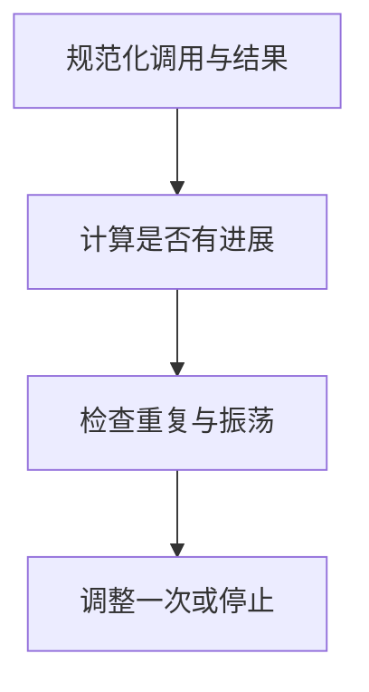

import InterviewQuestion from '../../../../components/InterviewQuestion.astro';

<InterviewQuestion>

同一工具连续调用可能是在分页或轮询，不能仅凭工具名判定死循环。检测同时看规范化参数、结果变化和任务进展，配合轮数、时限、费用三类硬预算。

## 记录语义状态而不是原始字符串

对调用参数做稳定序列化，对结果保存状态或内容哈希，识别连续相同调用与结果、状态往返和持续无新证据。合法轮询有等待间隔和截止时间。检测触发后可澄清、调整策略或退出，禁止无限自我修复。

### 写一个检测器要测哪些案例？

相同工具不同页码应继续，相同参数但结果正在变化未必停止，相同状态反复往返应触发。还要处理参数字段顺序、时间戳等噪声和取消后的迟到结果。

资料

核对于 2026-10-14。[ReAct 论文](https://arxiv.org/abs/2210.03629)、[OpenTelemetry Traces](https://opentelemetry.io/docs/concepts/signals/traces/)。正文场景、示例代码与方案取舍为教学示例；具体接口按选定版本核对。

</InterviewQuestion>
