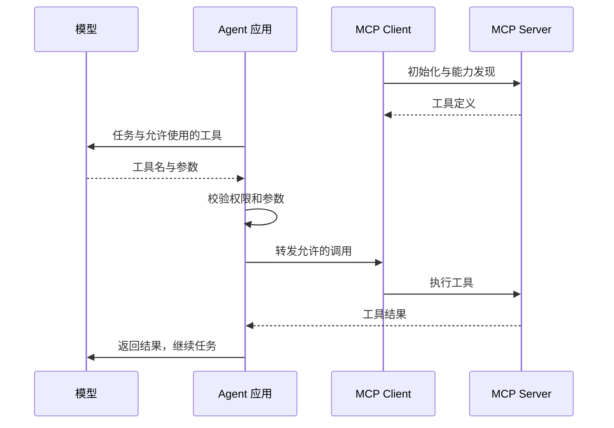

import InterviewQuestion from '../../../../components/InterviewQuestion.astro';

<InterviewQuestion>

Function calling 让模型表达“调用哪个工具、带什么参数”。MCP 规定应用怎样连接外部服务、发现能力并交换消息。应用可以把 MCP Server 暴露的工具转成模型能理解的工具定义，再把模型的调用转发过去。

Host 是承载 Agent 的应用，Client 管理与 Server 的连接，Server 提供工具等能力。MCP 还包括资源和提示模板，不能把整个协议等同于工具调用。

## 协议接通，权限仍要自己管

查数据库的 Server 可能暴露多个工具，当前用户只应拿到允许的能力。认证解决“是谁”，授权解决“能做什么”；业务服务还要检查数据归属。不要把一个高权限密钥交给所有会话共用。

本地 stdio 会启动或连接本地进程，HTTP 可连接远程服务。选择方式时要看部署位置、连接生命周期、认证和网络条件。接入远程服务还要设置超时，区分协议错误与工具业务失败。

### 有 MCP 之后，还需要自己写工具吗？

需要时仍然要写。MCP 统一连接方式，不会替你实现“按当前用户查订单”这样的业务逻辑。也可以包装 Server 工具，只暴露任务所需参数，屏蔽底层危险能力。

### MCP 和 A2A 又有什么区别？

MCP 主要连接应用与工具、资源等能力；A2A 主要描述 Agent 间的任务协作。采用哪个协议取决于接口要表达的对象，不是两个名字里选一个替代全部接口。

资料

核对于 2026-10-13。[AgentScope MCP](https://doc.agentscope.io/tutorial/task_mcp.html)、[Qwen-Agent MCP 接入](https://github.com/QwenLM/Qwen-Agent)、[MCP 官方架构](https://modelcontextprotocol.io/docs/learn/architecture)。授权与工具包装为工程设计建议。

</InterviewQuestion>
