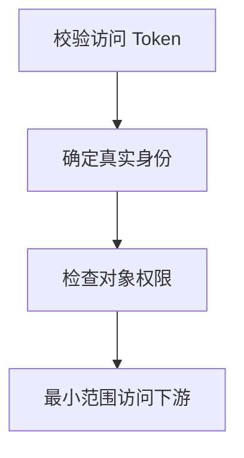

import InterviewQuestion from '../../../../components/InterviewQuestion.astro';

<InterviewQuestion>

MCP 授权解决客户端如何访问受保护的服务，业务授权仍决定当前身份可以操作哪些对象。HTTP 场景按所选协议版本处理 OAuth、资源元数据和 Token；本地 stdio 的凭据方式需要单独设计。

## 验证 Token 的目标与范围

服务校验签发者、受众、有效期和授权范围，再检查租户、对象归属与操作条件。不把收到的 Token 不加判断地转发给下游，也不把模型提供的用户标识当作登录身份。权限撤销要影响长会话和缓存。

### 一个 MCP Server 代理多个下游怎么办？

分别建立下游授权关系，明确代谁调用及最小范围。服务凭据留在执行层，模型只看到必要业务结果；审计保留实际身份与被代理对象。

资料

核对于 2026-10-14。[MCP Authorization 2025-11-25](https://modelcontextprotocol.io/specification/2025-11-25/basic/authorization)。正文场景、示例代码与方案取舍为教学示例；具体接口按选定版本核对。

</InterviewQuestion>
