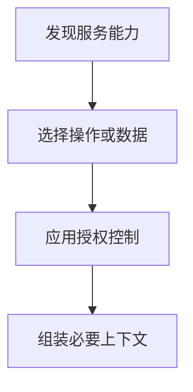

import InterviewQuestion from '../../../../components/InterviewQuestion.astro';

<InterviewQuestion>

Tools 暴露可执行操作；Resources 提供通过 URI 标识的上下文数据；Prompts 提供可复用的消息模板及参数。它们是不同能力，不是三个名称不同的工具接口。

## 控制数据进入上下文的方式

工具通常由模型提出调用，应用执行；资源由客户端按需读取或订阅；提示模板由用户或客户端选择并填充参数。具体交互由 Host 决定。资源 URI 不是公开访问许可，读取与模板展开仍要检查权限和内容可信度。

### 把所有资料都做成 Tool 可以吗？

可以实现类似效果，但会增加调用和参数设计负担，也失去资源发现及更新通知等语义。根据数据是否稳定、是否需要执行动作、客户端如何消费来选择。

资料

核对于 2026-10-15。[MCP Resources](https://modelcontextprotocol.io/specification/2025-11-25/server/resources)、[MCP Tools 2025-11-25](https://modelcontextprotocol.io/specification/2025-11-25/server/tools)、[MCP Prompts](https://modelcontextprotocol.io/specification/2025-11-25/server/prompts)。

</InterviewQuestion>
