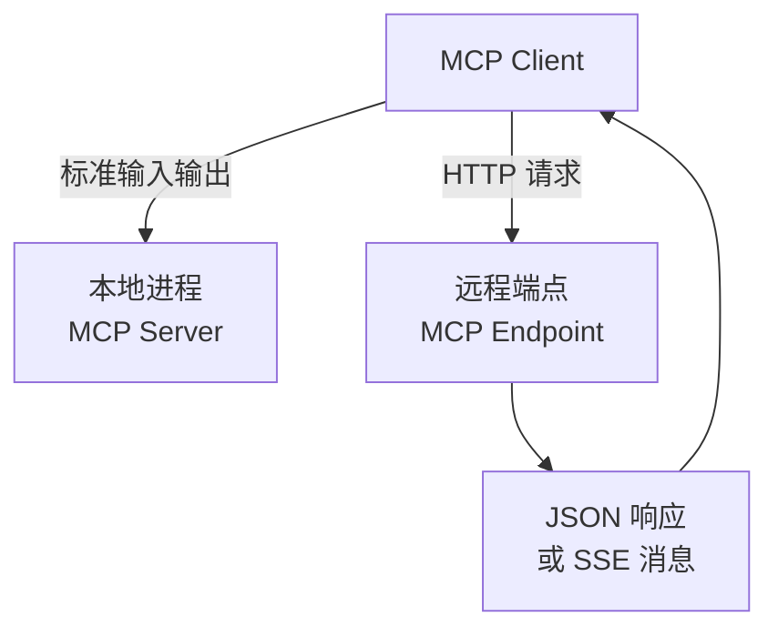

import InterviewQuestion from '../../../../components/InterviewQuestion.astro';

<InterviewQuestion>

stdio 通过本地进程的标准输入输出交换 MCP 消息，适合由客户端管理的本地服务。Streamable HTTP 用 HTTP 连接服务，可按协议返回 JSON 或通过 SSE 传递消息。这里的流式主要指协议消息传输，不等于音视频编解码或模型 Token 流。

## 选择取决于部署和生命周期

本地工具随桌面应用启动，stdio 可以直接管理进程；业务能力由多人共享时，远程 HTTP 更适合集中部署和认证。stdio 的普通诊断日志应写到 stderr，避免混入 stdout 损坏协议消息。

远程服务需要处理认证、Origin 校验、超时、连接断开和会话生命周期。传输层 Session ID 用于协议会话，不能替代应用的用户身份或业务权限。旧版 HTTP+SSE 与 Streamable HTTP 不应混称；接入时核对双方支持的协议版本。

### 断流后重连，就能保证工具只执行一次吗？

不能。消息恢复与业务副作用是不同问题。退款等动作仍需要下游幂等标识、执行状态查询和授权检查；连接恢复不证明之前的操作失败。

资料

核对于 2026-10-14，传输解释固定参考 [MCP 2025-11-25 Transports](https://modelcontextprotocol.io/specification/2025-11-25/basic/transports)。生产接入应再核对所用版本；幂等与权限建议属于应用设计。

</InterviewQuestion>
