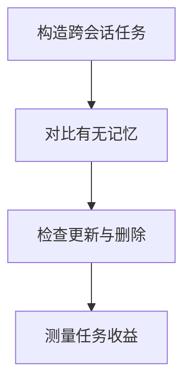

import InterviewQuestion from '../../../../components/InterviewQuestion.astro';

<InterviewQuestion>

评测记忆需同时检查写入、召回、更新和删除，以及对最终任务的贡献。命中率高可能只是记住了大量无关内容；应在多会话、时间变化和权限变化的任务上验证。

## 用对照实验检验增益

固定模型和任务，对比无记忆、现有记忆与改进方案。指标包含必要事实召回率、过期或错误记忆率、跨用户泄露、更新后正确率、删除后残留和任务成功率，同时记录额外 Token 与时延。

### 只保存最近 N 条为什么不够？

时间新不一定相关，较早的关键偏好可能被丢弃，近期一次错误也可能被反复使用。应根据类型、效用和失效规则保留，并用跨长周期任务检验遗忘策略。

资料

核对于 2026-10-15。[LongMemEval：跨会话、时间推理、知识更新与拒答评测](https://arxiv.org/abs/2410.10813)。删除、权限泄露和成本指标为本文补充的工程验收项，不是该基准默认覆盖的全部能力。

</InterviewQuestion>
