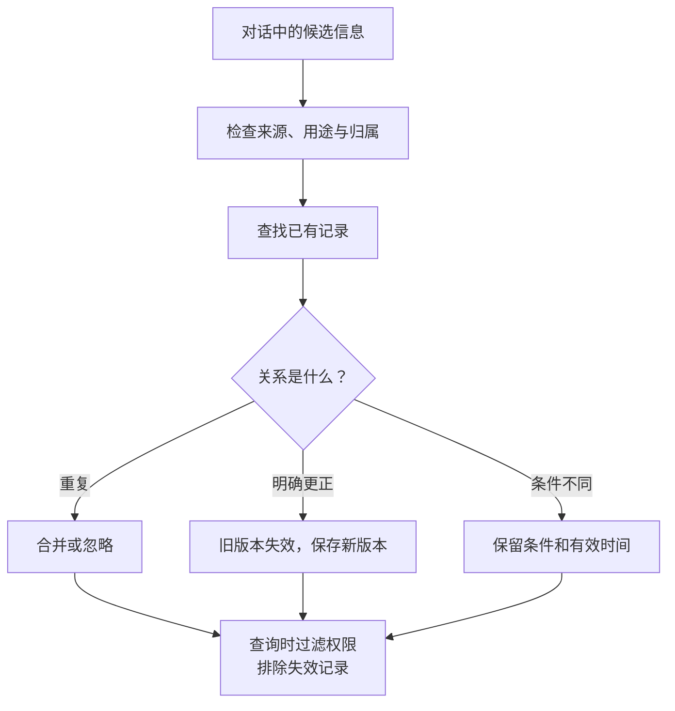

import InterviewQuestion from '../../../../components/InterviewQuestion.astro';

<InterviewQuestion>

长期记忆应保存经过筛选、以后仍有用的信息，并支持更正、失效和删除。记录至少包括主体、内容、来源与有效时间。用户更正可能替换旧偏好，也可能只适用于这一次任务；不能把每句新话都当作永久画像。

## 相似不是同一条事实

教学例：“平时住杭州”和“本周出差南京”可以同时成立；“以后别用英文回复”则可能更新语言偏好。先对齐主体、属性、条件和时间，再决定追加或替换，不能仅靠向量相似度覆盖记录。

更新应留下版本，避免后台任务基于旧数据覆盖新更正。删除需要处理主记录、检索索引和缓存；审计或备份的留存方式另行规定，不能把“查询时不返回”说成所有副本已经消失。

### 模型可以直接把推测写进去吗？

推测不应成为已确认事实。外部网页的指令也不能作为用户偏好保存。记忆检索按用户与租户隔离；语义相关不代表有权限读取。

资料

核对于 2026-10-15。[LangChain 长期记忆与命名空间](https://docs.langchain.com/oss/python/langchain/long-term-memory)、[AgentScope 长期记忆](https://doc.agentscope.io/tutorial/task_long_term_memory.html)。更新、删除和冲突方案为本站工程建议。

</InterviewQuestion>
