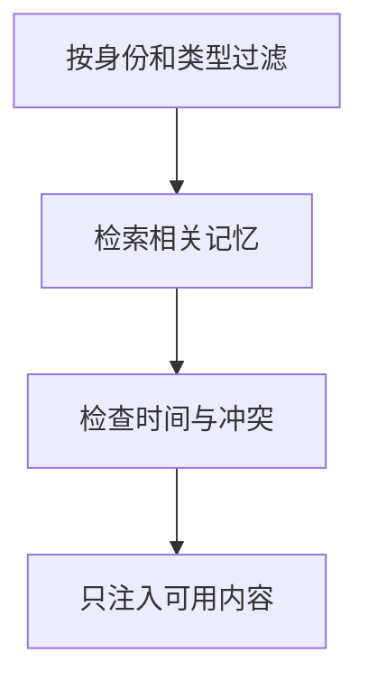

import InterviewQuestion from '../../../../components/InterviewQuestion.astro';

<InterviewQuestion>

记忆召回应同时考虑语义相关、身份范围、时间和可信程度。记录来源、更新时间与失效条件，先做权限和类型过滤，再排序；相似度高不代表当前仍然适用。

## 区分事实、偏好和任务经验

用户偏好可以跨会话使用，订单状态通常需要实时查询，某次失败经验要限定工具和版本。冲突事实保留版本并选择有效项，不把旧记忆重复追加到每轮上下文。被删除或撤回授权的记忆不能继续通过缓存命中。

### 怎样评估召回是否污染了任务？

比较无记忆、正确记忆、过期记忆和其他用户相似记忆下的结果，检查错误引用与越权。记录模型最终使用了哪条记忆，不能只测检索命中率。

资料

核对于 2026-10-14。[LangGraph Persistence](https://docs.langchain.com/oss/python/langgraph/persistence)。正文场景、示例代码与方案取舍为教学示例；具体接口按选定版本核对。

</InterviewQuestion>
