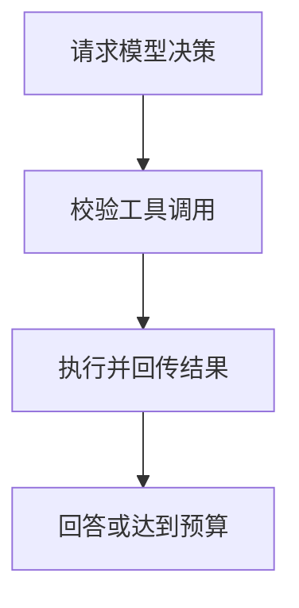

import InterviewQuestion from '../../../../components/InterviewQuestion.astro';

<InterviewQuestion>

最小循环需要模型接口、工具注册表、消息状态和明确的停止条件。模型只提出调用，执行器负责校验和运行，再把结果按调用标识送回。示例先实现串行读取，生产副作用另加授权与幂等。



## 核心控制流程

下面是协议无关的 Python 示例，model.step 与 validate 由接口适配器实现。预算按实际请求计费另行统计，不把示例当成生产代码。

```python
def run_agent(model, messages, tools, validate, max_steps=8):
    for _ in range(max_steps):
        reply = model.step(messages, tools)
        messages.append(reply.message)
        if not reply.calls:
            return reply.text
        for call in reply.calls:
            try:
                tool = tools[call.name]
                args = validate(tool.schema, call.args)
                result = tool.read(args)  # 示例只开放读取
            except (KeyError, ValueError) as exc:
                result = {"status": "rejected", "reason": str(exc)}
            messages.append(model.tool_result(call.id, result))
    raise RuntimeError("step budget exhausted")
```

### 这个示例还缺哪些生产能力？

真实接口还需超时、取消、总预算、错误分类、轨迹和状态恢复。写工具必须经授权代理执行；不要捕获所有异常后让模型无限重试，也不要在循环结束时伪造成功。

<details data-reader-ignore>
<summary>资料</summary>

核对于 2026-10-15。[ReAct 论文](https://arxiv.org/abs/2210.03629)、[Spring AI 工具调用](https://docs.spring.io/spring-ai/reference/api/tools.html)。

</details>

</InterviewQuestion>
