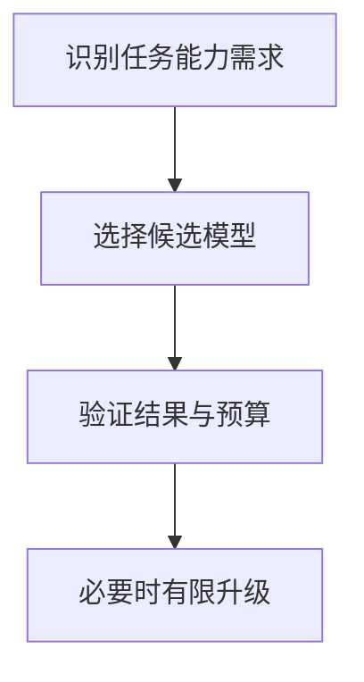

import InterviewQuestion from '../../../../components/InterviewQuestion.astro';

<InterviewQuestion>

模型路由把简单任务交给较低成本模型，把需要复杂推理或特定能力的任务交给更强模型。规则应来自任务评测与服务约束，不能只用模型自己声称的置信度判断。

## 升级触发需要可观测证据

按任务类型、上下文长度、工具复杂度和历史表现路由。结构校验失败、证据不足或任务超出能力时可升级，但权限拒绝不能通过换模型绕过。升级共享同一预算与任务状态，避免重复写操作。

### 怎样证明路由比统一大模型划算？

在同一任务集对比整体成功率、关键类别退化、成本、P95 时延与升级率。关注误把困难任务发给小模型的损失，不能只比较平均单次调用价格。

资料

核对于 2026-10-14。[Spring AI 工具调用](https://docs.spring.io/spring-ai/reference/api/tools.html)。正文场景、示例代码与方案取舍为教学示例；具体接口按选定版本核对。

</InterviewQuestion>
