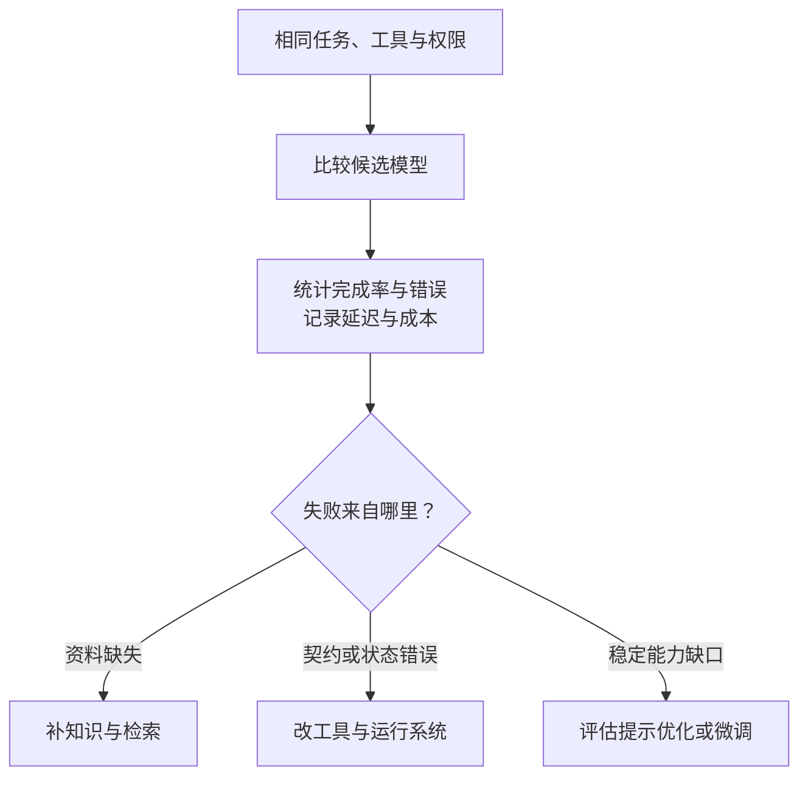

import InterviewQuestion from '../../../../components/InterviewQuestion.astro';

<InterviewQuestion>

先确定任务、验收规则和成本约束，再比较模型。通用榜单只能筛选候选；Agent 还要测工具选择、参数、长任务稳定性、延迟和每次成功任务的总成本。微调应针对稳定的能力缺口，不能替代缺失的知识、坏工具或错误的上下文。

## 比较的是完整任务

假设任务需要查订单、解释状态并给出处理建议。更便宜的模型若经常选错工具，触发重试或人工处理，整次任务可能更贵。记录模型和提示版本、输入输出量、工具次数及成功标准，才能复现对比。

新增经常变化的企业规则，通常先考虑检索或业务工具。需要稳定学习一种输出习惯、工具选择模式或领域行为，再评估有标注数据的微调；训练集、开发集和保留测试集应隔离。上线前还要检查原有能力是否退化。

### 面试时怎么讲“哪个模型好用”？

说明任务、对比条件、指标和失败案例。有测量就给结果；没有测量就说尚未验证，列出准备怎样比较。个人试用感受不能直接当成业务验收结论。

资料

核对于 2026-10-15。[AgentScope 评测](https://doc.agentscope.io/tutorial/task_eval.html)、[Qwen-Agent 模型与工具接入](https://github.com/QwenLM/Qwen-Agent)。失败归因、选型和微调条件为本站工程建议。

</InterviewQuestion>
