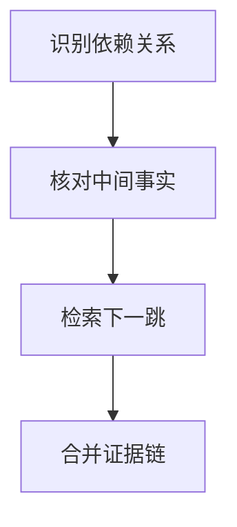

import InterviewQuestion from '../../../../components/InterviewQuestion.astro';

<InterviewQuestion>

多跳检索需要先找到中间事实，再用它查询下一步。每个中间结论应带来源和置信边界；未验证的模型推断不能直接变成下一跳的事实条件。

## 分清独立问题与依赖问题

“某产品供应商的退款政策”需要先确认供应商，再查对应政策；两款产品的价格则可并行查询。用依赖图记录子问题、所需实体和已取得证据，结果不足时回到上一跳修正，不把所有子问题都强行并行。

### 第一跳找不到明确答案怎么办？

可以尝试限定版本、改写或替换数据源，但不能编造一个实体继续检索。设置停止条件，向用户说明哪一跳缺少资料，并保留已完成部分。

资料

核对于 2026-10-15。[LangChain 检索架构](https://docs.langchain.com/oss/python/deepagents/retrieval)。

</InterviewQuestion>
