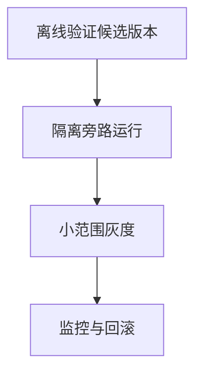

import InterviewQuestion from '../../../../components/InterviewQuestion.astro';

<InterviewQuestion>

离线通过后，在小范围用户或任务上灰度验证；Shadow 使用相同输入旁路运行，不向用户提交结果，也不执行真实写入。线上监控要覆盖任务质量、安全、成本和长尾时延。

## 发布单元要可回滚

发布绑定模型、Prompt、Skill、工具和知识版本。按任务类型比较成功、转人工、投诉与错误率，并设置关键指标退化门槛。Shadow 用模拟写工具或只读权限，否则所谓旁路也可能产生业务副作用。

### 离线分数没变，线上投诉却增加怎么办？

先看流量和任务分布是否变化，再核对知识、权限、下游与耗时。将线上新失败纳入独立评测集，避免只优化已有样本；必要时回滚具体版本。

资料

核对于 2026-10-15。[SageMaker Shadow 旁路请求与结果处理](https://docs.aws.amazon.com/sagemaker/latest/dg/model-shadow-deployment.html)、[OpenTelemetry Traces](https://opentelemetry.io/docs/concepts/signals/traces/)。Agent 写工具隔离、灰度门槛与回滚为工程设计，不是旁路复制流量就自动具备的保证。

</InterviewQuestion>
