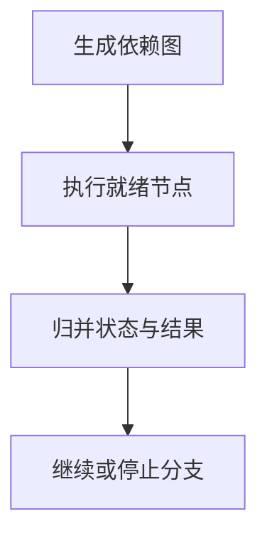

import InterviewQuestion from '../../../../components/InterviewQuestion.astro';

<InterviewQuestion>

先用依赖图区分可以并行的读取与必须串行的操作。并行能缩短独立任务的等待时间，但涉及相同资源的写操作需要冲突控制，不能因为模型同一轮提出多次调用就全部执行。

## 调度器负责预算与状态

任务节点保存依赖、超时、重试和结果，只有前置节点成功才进入就绪队列。限制全局、租户和下游并发；部分失败时明确是否继续独立分支。取消传播到未启动和可取消任务，已产生副作用的操作单独对账。

### 一个分支失败，其他分支要回滚吗？

看业务是否要求原子性。分布式写操作通常不能靠撤销模型消息回滚，应设计补偿或人工恢复。纯读取可以保留已成功结果，并告知完整性不足。

资料

核对于 2026-10-15。[Spring AI 工具调用](https://docs.spring.io/spring-ai/reference/api/tools.html)、[LangGraph Persistence](https://docs.langchain.com/oss/python/langgraph/persistence)。

</InterviewQuestion>
