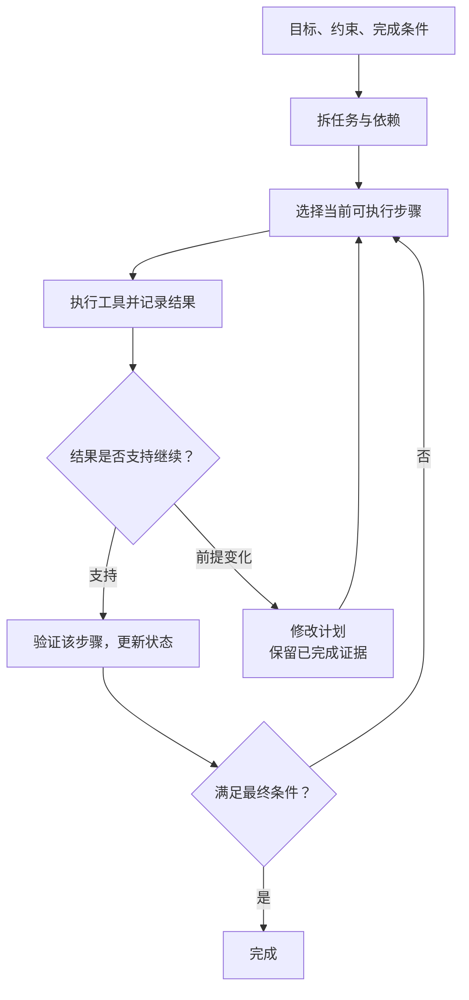

import InterviewQuestion from '../../../../components/InterviewQuestion.astro';

<InterviewQuestion>

ReAct 根据当前信息选一步动作，拿到结果后再选下一步。先规划再执行会提前拆任务、写出依赖，再逐步完成。前者适合路径要靠探索才能确定的任务，后者适合有明确子任务的长流程；实际系统可以结合两种方式。

写调研报告时，可以先列“找资料、核对数据、写稿”三个阶段；找资料阶段再按检索结果决定下一次查询。计划记录的是待办和依赖，不是模型说了一遍就已经完成。

## 哪些变化值得重做计划

找到的新事实推翻了原假设、权限被拒绝、必要工具不可用，或者剩余预算不够，都需要重新判断路径。一次临时网络错误通常只需有限重试，不必让模型推翻整个计划。

步骤状态由实际结果更新。文件确实生成并可读取，才能把“生成文件”记为完成；“接下来我会生成”只是一段文本。每个阶段保留简短证据，重规划时避免把已经做完的副作用再做一遍。

### 每次调用前都写长计划，会更好吗？

短任务可能只增加延迟和 Token。先判断任务是否有多步依赖、是否需要恢复和审核，再决定计划粒度。也不用保存完整内部推理，保存行动、依据和结果足够用于排障。

### Agent 一直重规划，怎么停？

限制步骤数和总时长，检测同一状态下反复提出相同行动。停下时说明卡在哪里、还缺什么条件，并保留已完成结果，不能用一段“任务完成”掩盖失败。

资料

核对于 2026-10-13。[AgentScope Plan 模块](https://doc.agentscope.io/tutorial/task_plan.html)、[Spring AI Alibaba 规划拦截器](https://github.com/spring-ai-alibaba/website/blob/main/docs/frameworks/agent-framework/tutorials/hooks.md)、[ReAct 原始论文](https://arxiv.org/abs/2210.03629)。调研流程及验证规则为工程示例。

</InterviewQuestion>
