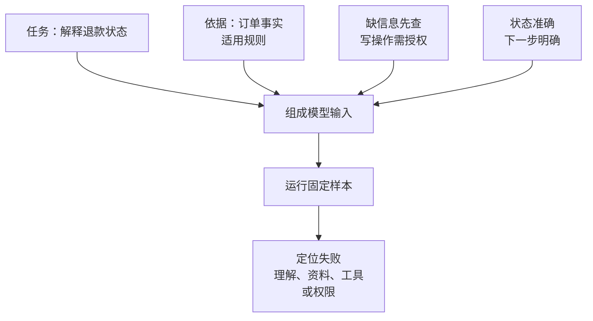

import InterviewQuestion from '../../../../components/InterviewQuestion.astro';

<InterviewQuestion>

好的提示词把“做什么、根据什么做、做到什么程度”讲清楚。只写“你是资深客服，认真回答”，模型仍不知道哪些资料可信、能否操作订单，以及怎样判断任务完成。

例如退款咨询，可以规定：根据订单服务返回的状态解释退款规则；信息不足时查订单或询问；未经授权不提交退款；回复包含当前状态和下一步。订单事实由工具提供，权限由服务端检查，提示词负责说明任务。

## 示例要展示决策，不只展示语气

few-shot 是给模型少量输入输出示例。示例应覆盖容易混淆的情况：订单已退款怎样答，订单号缺失怎样问，用户要求越权查询怎样拒绝。十个几乎一样的正常回答，未必比一个边界案例更有用。

把外部资料放在明确的数据区，保留来源和时间。规则冲突时先修规则，不要不断补上“务必、绝对、再次强调”。提示词越长，冲突和无关信息也可能越多。

### 答案错了，怎么判断还值不值得改提示词？

模型看到了正确资料却误解了任务，可以调整表达和示例。资料没有召回，修检索；工具没有能力，补接口；权限判断不可靠，修服务端。用提示词要求模型记住最新库存，解决不了数据源问题。

### 改完提示词怎样验证？

保留一组正常、缺信息、冲突和历史失败样本，比较结果和工具轨迹。每次只改有明确原因的部分，记录版本，避免凭一次“回答顺眼”就认定变好。

资料

核对于 2026-10-13。[阿里云 Prompt 工程指南](https://help.aliyun.com/zh/model-studio/prompt-engineering-guide)、[Qwen-Agent 的任务与工具示例](https://github.com/QwenLM/Qwen-Agent)。退款任务和排障判断为工程示例。

</InterviewQuestion>
