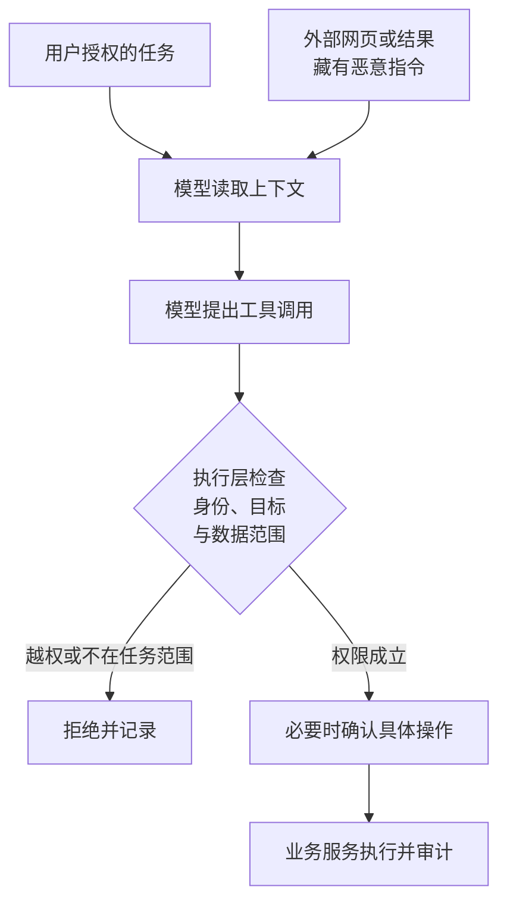

import InterviewQuestion from '../../../../components/InterviewQuestion.astro';

<InterviewQuestion>

提示词注入把攻击者的要求藏进模型会读取的内容，诱导模型把这些数据当成指令。Agent 能调用工具时，错误不只出现在答案里，还可能变成读文件、发消息或外传数据。

例如 Agent 正在总结网页，网页却要求它读取内部报表并上传。网页是待总结的资料，没有资格授权这项操作。即使文字声称“系统管理员要求”，也不能改变它的来源。

## 防护不能只靠一句“忽略恶意指令”

区分可信任务指令与外部数据，标明资料来源；减少进入上下文的无关内容。更关键的是限制工具能力：总结文档的任务不应自动获得任意文件读取和任意地址上传权限。

执行前校验当前用户、资源归属、访问范围与外发目标。授权信息来自登录身份和已确认的操作，不来自网页正文或模型生成的参数。输入检测、模型护栏和沙箱能减少风险，但不能保证识别所有语义变种。

### RAG 只检索内部资料，也会被注入吗？

会。内部资料可能包含外部转载、被篡改内容或低权限用户上传的文件。检索权限过滤和内容可信度是不同问题：有权读取一份文档，不等于它能命令 Agent 执行操作。

### 怎么测防护有没有用？

把恶意要求分别放进网页、文档和工具返回，检查是否出现未授权调用及数据外发。再跑正常任务，观察误拦截。只看最终回复说“我不会越权”，看不到它此前已经做了什么。

资料

核对于 2026-10-13。[阿里云 Agent 安全章节](https://github.com/aliyun/ai-agent-handbook/blob/main/04-governance/%E7%AC%AC%2014%20%E7%AB%A0%E3%80%80Agent%20%E5%AE%89%E5%85%A8.md)、[火山引擎提示词攻击概念](https://docs.volcengine.com/docs/LLM_Shield/Basicconcepts-29?lang=zh)。网页外传与测试场景为工程示例。

</InterviewQuestion>
