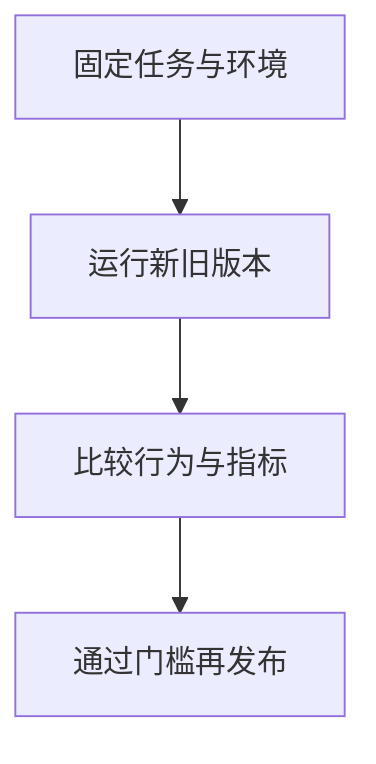

import InterviewQuestion from '../../../../components/InterviewQuestion.astro';

<InterviewQuestion>

把 Prompt、Skill、工具 Schema 和模型配置一起版本化，用固定任务及环境比较变更前后表现。成功案例要测试，历史失败、边界、权限拒绝和无答案任务也要保留。

## 比较完整行为而非措辞

检查任务结果、工具选择、参数、调用次数、副作用、成本和时延。模型输出有随机性，对关键任务多次运行并记录分布。候选变更先离线验证，再在受控范围上线；保留回滚版本。

### Prompt 只是改了几个字，还需要评测吗？

文字变更可能改变工具选择或让某项规则被忽略。验证范围按影响面选择，小改动可跑相关子集，但安全和关键写操作应保留固定回归项。

资料

核对于 2026-10-14。[Agent Skills 规范](https://agentskills.io/specification)、[OpenTelemetry Traces](https://opentelemetry.io/docs/concepts/signals/traces/)。正文场景、示例代码与方案取舍为教学示例；具体接口按选定版本核对。

</InterviewQuestion>
