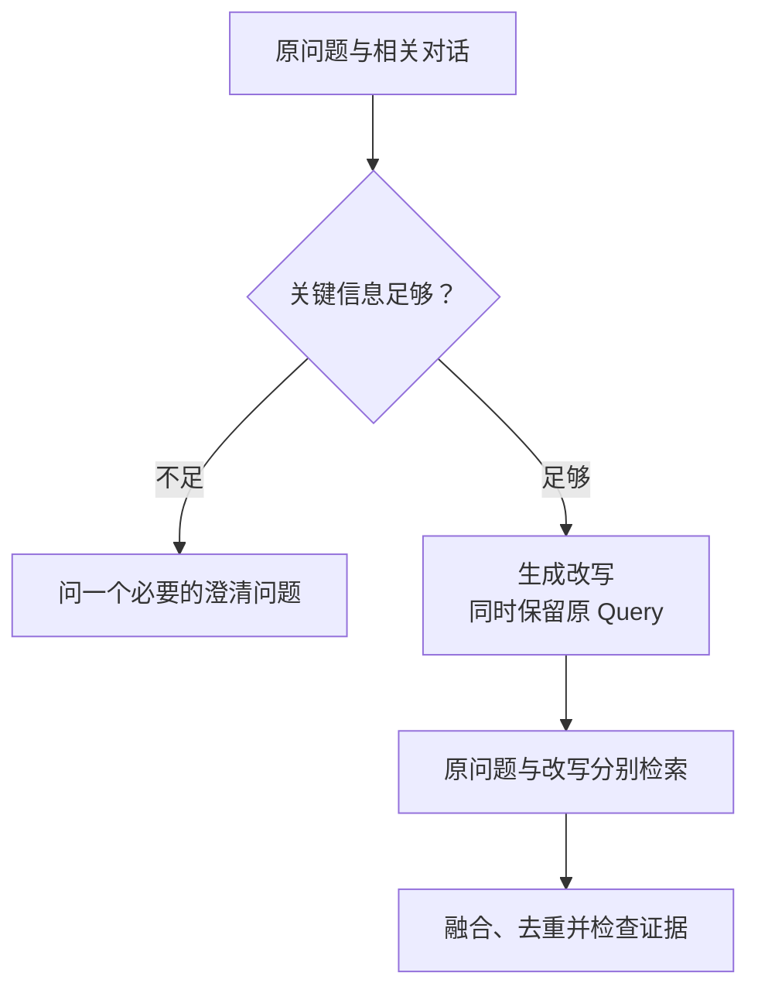

import InterviewQuestion from '../../../../components/InterviewQuestion.astro';

<InterviewQuestion>

Query Rewrite 把用户表达转成更适合检索的查询，同时保留原意。它可以纠正常见错字、补回对话中明确的对象、拆解多个问题；缺失的信息若会改变答案或动作，就应该澄清，不能让模型自行猜出城市、日期或用户权限。

## 哪些内容可以补，哪些不能补

教学例：“它能退吗？”若上一轮明确是订单 T42，可以补成该订单的退款问题；若有两个订单，就先问是哪一个。型号、错误码和人名要保留，避免“纠错”把有效标识改成常用词。

长查询可以拆成带共享条件的子问题，例如把“申请条件、额度和例外”分别召回，再合并证据。原查询应保留为回退路径，改写结果不直接覆盖事实来源。

### 怎么证明改写有效？

固定语料和正确证据，对比改写前后的召回与最终答案。单独统计意图被改错、错误实体替换和多余澄清；不能只看 Embedding 分数变高。若改写没带来稳定收益，保留更简单的方案。

资料

核对于 2026-10-14。[阿里云百炼知识检索](https://help.aliyun.com/zh/model-studio/rag-knowledge-retrieval)。改写保留、澄清条件与订单场景为本站工程设计。

</InterviewQuestion>
