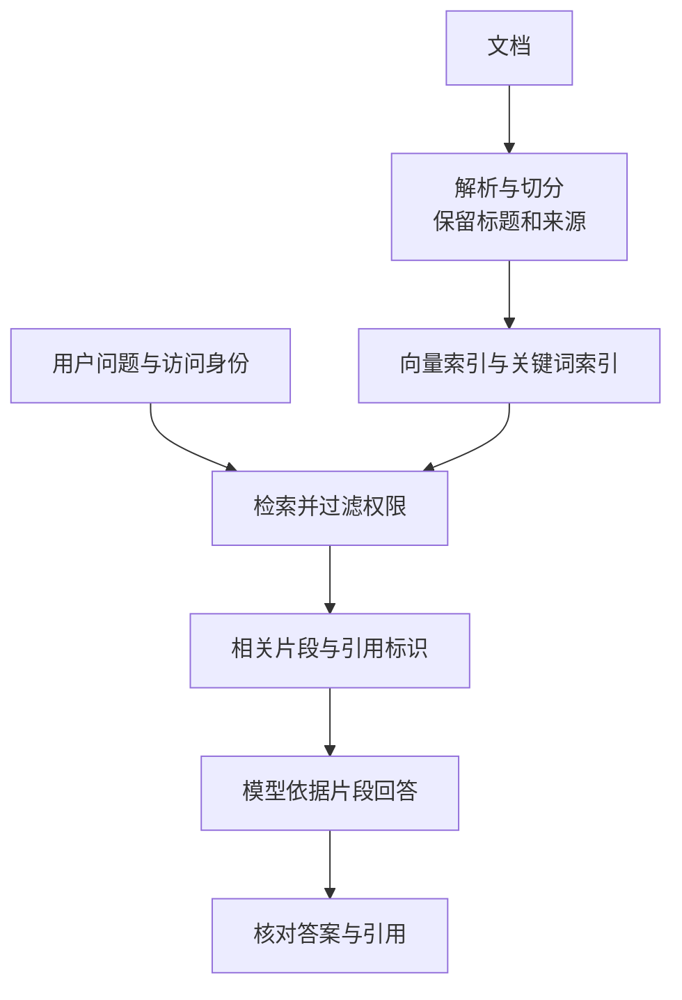

import InterviewQuestion from '../../../../components/InterviewQuestion.astro';

<InterviewQuestion>

RAG 先从外部资料找相关片段，再把片段交给模型回答。它通常不修改模型权重，知识更新靠更新文档和索引。能找到资料，也不代表模型一定会忠实引用。

建库时，解析文档，按语义边界切成片段，保存来源、版本和权限，并生成向量或关键词索引。查询时，把问题送进检索器，选出相关片段，连同问题交给模型；答案里的引用要能指回原文。

## 切得太小和太大都会出问题

一条“离职员工不适用”的例外，不能和补贴规则分到互不关联的片段。可以按标题、段落、条款切分，把父级标题带上；表格保留表头，代码保留必要上下文。相邻片段适量重叠，能减少边界丢信息，但也增加重复和存储。

切得太大，检索命中后会带进很多无关内容；切得太小，条件、结论和例外容易分开。没有通用最优长度，用真实问题检查“找得到，而且片段足够回答”更可靠。

### Embedding 相似度高，意味着答案正确吗？

Embedding 把文本编码成向量，距离可用于寻找语义相近的内容。相近不等于支持结论，“允许退款”和“禁止退款”可能谈同一件事。还要检查条件、日期及原文是否真的支持回答。

### 文档改了，只上传新版本就够了吗？

需要让旧片段失效或删除，并更新索引、版本和引用。更换 Embedding 模型时，旧向量通常不能直接与新向量混用；要验证兼容性，必要时重建索引。

资料

核对于 2026-10-13。[AgentScope RAG：Reader、Document 与检索](https://doc.agentscope.io/tutorial/task_rag.html)、[百炼知识库节点](https://help.aliyun.com/zh/model-studio/workflow/knowledge-base-node)。补贴条款与更新流程为工程示例。

</InterviewQuestion>
