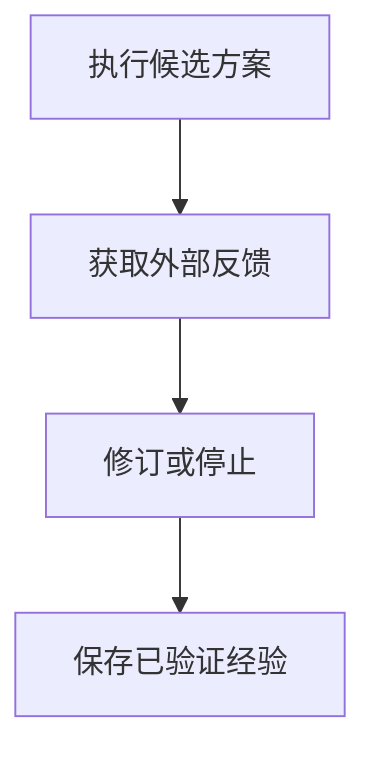

import InterviewQuestion from '../../../../components/InterviewQuestion.astro';

<InterviewQuestion>

Reflection 是对已生成方案或执行结果进行检查与修改；Reflexion 的代表做法还会把失败反馈转成文字经验，供后续尝试使用。它们能提供纠错机会，但同一模型再次判断不构成独立验证。

## 先得到可靠反馈

代码任务可以用编译、测试和静态检查给出反馈；检索任务可以核对引用能否支持结论。将错误类型、证据和下一次行动写成结构化记录，限制反思轮数。未经验证的“经验”不能直接进入所有用户共享的长期记忆。

### 连续反思为什么还可能越改越错？

如果评价器本身误判，后续步骤会围绕错误反馈优化。应保留可回退的版本，把确定性检查放在前面，对模型评分抽样人工校准；没有新增证据或进展时停止。

资料

核对于 2026-10-14。[Reflexion 论文](https://arxiv.org/abs/2303.11366)。正文场景、示例代码与方案取舍为教学示例；具体接口按选定版本核对。

</InterviewQuestion>
