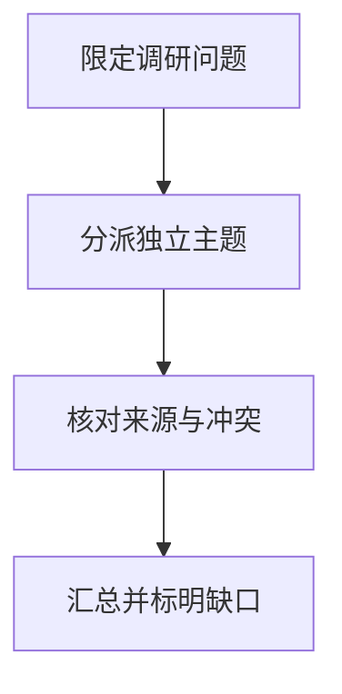

import InterviewQuestion from '../../../../components/InterviewQuestion.astro';

<InterviewQuestion>

调研先限定问题、时间范围和交付标准，再把可独立主题交给子任务。每个结论携带出处、日期和支持段落，汇总时核对冲突与重复；搜索结果标题不能当作已读证据。

## 让证据跟随结论传递

子任务输出事实、推断和未核实事项，优先原始论文或官方资料。协调者维护覆盖表，检查缺少的主题、过期材料和同一来源的重复转载。失败分支可重试或缩小范围，最终报告明确缺口。

### 并行调研一定更快吗？

只有可独立工作才容易获益。重复检索、上下文交接和汇总会增加成本，用同一问题比较单 Agent 与多 Agent 的覆盖、准确度、耗时和用量。

资料

核对于 2026-10-14。[LangChain 多 Agent 模式](https://docs.langchain.com/oss/python/langchain/multi-agent)。正文场景、示例代码与方案取舍为教学示例；具体接口按选定版本核对。

</InterviewQuestion>
