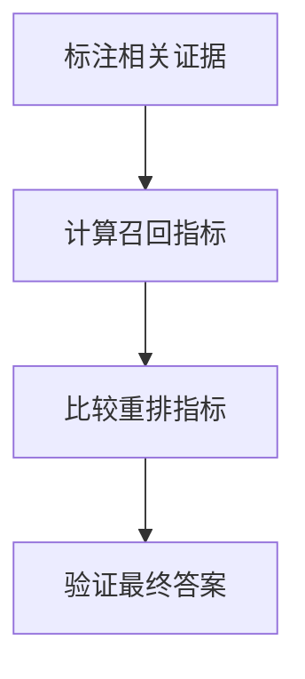

import InterviewQuestion from '../../../../components/InterviewQuestion.astro';

<InterviewQuestion>

Precision@k 看前 k 个结果中相关项的比例；Recall@k 看标注相关项被找回的比例；MRR 关注第一个相关结果的倒数排名；NDCG 用相关等级和位置折扣衡量排序。它们评价检索，不能直接证明答案正确。

## 先说明标注和分母

若前五项中有两项相关，Precision@5 为 2/5。Recall 的分母是该问题已标注的相关项数，不是整个数据库。MRR 适合关注首个可用结果，NDCG 更适合存在强弱相关等级的情况。固定知识版本、k、去重规则和不可回答问题的处理方式。

### 检索指标提高，答案却变差怎么办？

检查新增结果是否引入冲突、过期信息或过长上下文，再对比引用准确率和最终任务成功率。还要分别检查候选召回与重排，避免把两个阶段的变化混在一起。

资料

核对于 2026-10-14。[LangChain 检索架构](https://docs.langchain.com/oss/python/deepagents/retrieval)。正文场景、示例代码与方案取舍为教学示例；具体接口按选定版本核对。

</InterviewQuestion>
