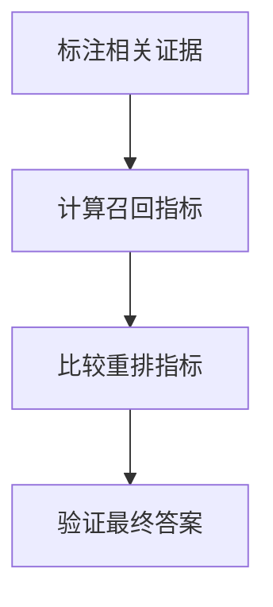

import InterviewQuestion from '../../../../components/InterviewQuestion.astro';

<InterviewQuestion>

Precision@k 看前 k 个结果中相关项的比例；Recall@k 看已标注相关项被找回的比例；MRR 对多条查询的首个相关结果倒数排名取平均；NDCG 把考虑相关等级和位置折扣的排序得分，除以理想排序得分。它们评价检索，不能直接证明答案正确。

## 先说明标注和分母

若前五项中有两项相关，Precision@5 为 2/5；该问题一共标注了四项相关证据，则 Recall@5 为 2/4。标注不完整时，测到的是这份标注集上的召回率，不能当作全库真实召回率。

例如三条查询的首个相关结果分别排第 1、第 2 和前 k 项内未找到，MRR@k 为 `(1 + 1/2 + 0)/3 = 0.5`。它重视首个可用结果，不反映所有相关项的排序；NDCG 更适合评价有强弱相关等级的整段排序。

固定知识版本、k 和去重规则。没有相关项的查询，Recall 的分母为 0，NDCG 的理想得分也可能为 0；需预先约定排除或计分规则，并单独评测不可回答问题，避免混用评测库默认值。

### 检索指标提高，答案却变差怎么办？

检查新增结果是否引入冲突、过期信息或过长上下文，再对比引用准确率和最终任务成功率。还要分别检查候选召回与重排，避免把两个阶段的变化混在一起。

资料

核对于 2026-10-15。[Sentence Transformers 检索评测器](https://sbert.net/docs/package_reference/sentence_transformer/evaluation.html)、[Stanford：排序检索评测](https://nlp.stanford.edu/IR-book/html/htmledition/evaluation-of-ranked-retrieval-results-1.html)。数字为按上述定义计算的示例。

</InterviewQuestion>
