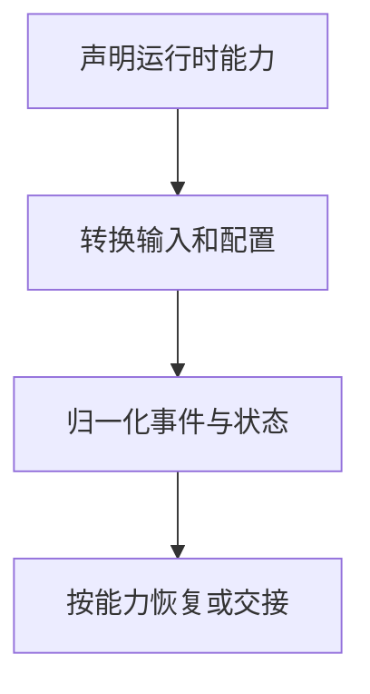

import InterviewQuestion from '../../../../components/InterviewQuestion.astro';

<InterviewQuestion>

适配层统一任务输入、运行事件、取消与产物，但不能假定各 Runtime 具有相同的检查点、工具或恢复语义。先定义最小接口，再显式声明可选能力和限制。

## 统一事件，保留原始语义

标准事件至少记录 run_id、序号、事件类型、状态和时间；保留底层事件用于排障。适配器转换配置、工具和权限时做验证，测试正常运行、错误、取消、断流与恢复。摘要交接和原生状态恢复应分别暴露。

### 怎样判断换 Runtime 没有退化？

同一任务集对比成功率、工具副作用、产物和成本，验证状态转换及恢复路径。只跑通一条对话，无法说明不同 Runtime 的能力兼容。

资料

核对于 2026-10-15。[LangGraph Persistence](https://docs.langchain.com/oss/python/langgraph/persistence)、[LangChain Middleware](https://docs.langchain.com/oss/python/langchain/middleware/built-in)。

</InterviewQuestion>
