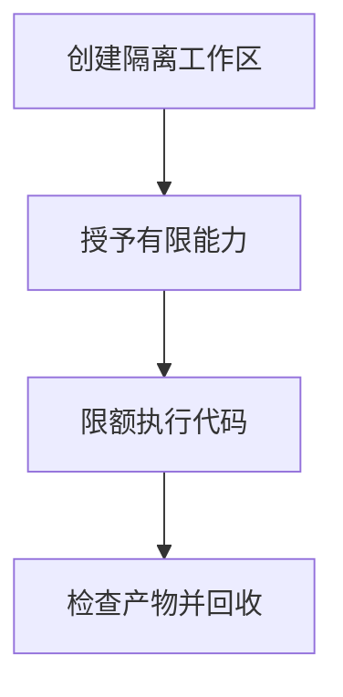

import InterviewQuestion from '../../../../components/InterviewQuestion.astro';

<InterviewQuestion>

沙箱限制文件、网络、系统调用、凭据和资源，使模型生成的代码只能在授权范围执行。容器是隔离的一种手段，共享宿主内核；强隔离需求可能需要更严格的运行环境。

## 按任务授予最小能力

使用专用工作区、非特权身份、只读基础文件系统及 CPU、内存、进程数和运行时限。网络采用明确目的地规则，业务密钥不进入代码环境。产物导出检查路径、大小和类型，失败任务及时回收资源。

### 把执行命令写进黑名单够吗？

不够，命令组合、解释器和网络都可能绕过字符串限制。安全边界由运行环境与授权代理执行，命令规则只是补充；测试越界文件访问、资源耗尽和网络绕过。

资料

核对于 2026-10-14。[Docker Engine Security](https://docs.docker.com/engine/security/)。正文场景、示例代码与方案取舍为教学示例；具体接口按选定版本核对。

</InterviewQuestion>
