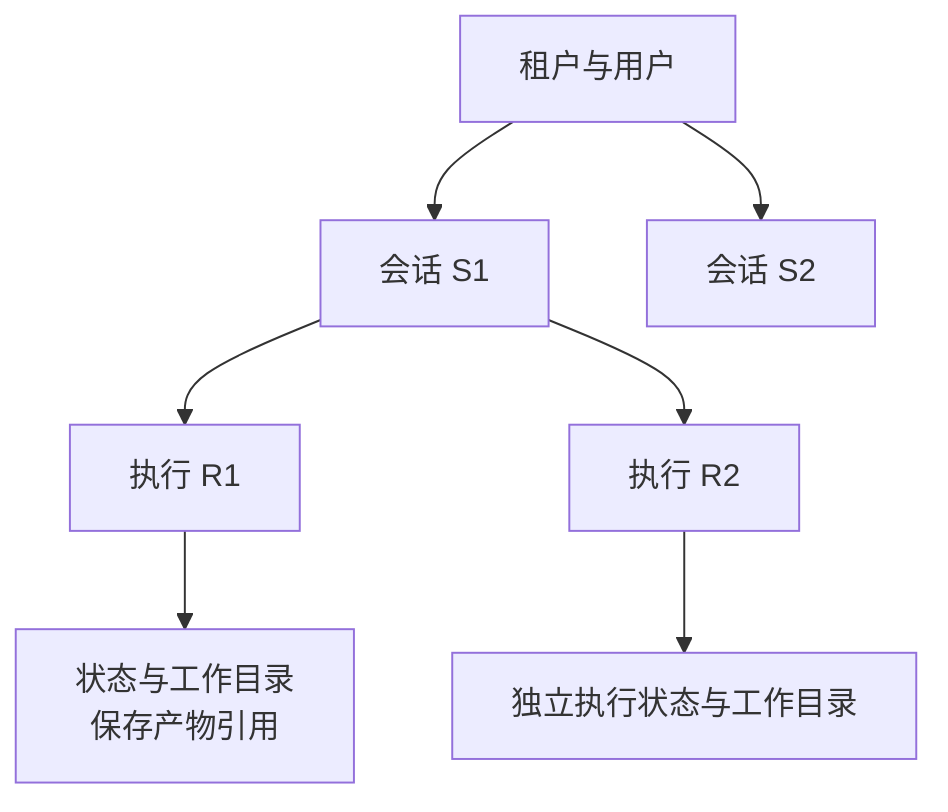

import InterviewQuestion from '../../../../components/InterviewQuestion.astro';

<InterviewQuestion>

user_id 标识用户，session_id 标识一段对话，run_id 标识一次具体执行。一个用户可有多段对话，一段对话可启动多次执行。UUID 避免碰撞，不证明访问权限；读取状态或文件时，仍要核对它属于谁。

## 两次执行不能覆盖彼此的进度

教学例：用户连续发两条消息，后一次执行不应覆盖前一次未完成的工具结果。可以串行处理同会话的状态变更，或使用版本校验明确冲突规则；工作目录按租户和执行隔离，避免都写一个 output.json。

由任务服务管理文件归属、引用和保留期，工具进程只使用分配的目录。临时文件可以有到期清理，但要排除正在运行或等待恢复的任务；需保留的产物先移入持久存储。别因清理进程退出就误删恢复所需的输入。

### 容器重启后目录还在吗？

取决于存储。容器临时磁盘通常不能作为恢复承诺；检查点、文件和执行记录应放在满足持久性要求的位置，并实际测试重启恢复。身份和租户信息由可信服务注入，不能由模型参数决定。

资料

核对于 2026-10-15。[AgentScope 状态与会话](https://doc.agentscope.io/tutorial/task_state.html)、[LangChain 短期记忆](https://docs.langchain.com/oss/python/langchain/short-term-memory)。标识、文件生命周期和冲突方案为本站工程设计。

</InterviewQuestion>
