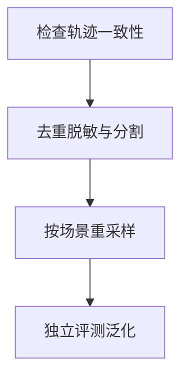

import InterviewQuestion from '../../../../components/InterviewQuestion.astro';

<InterviewQuestion>

SFT 数据要确保任务、工具轨迹和答案一致，过滤格式错误、无依据成功和敏感内容。清洗后按场景难度与数据质量重采样，避免大量简单近重复样本淹没关键失败类型。

## 划分先于扩增与模板生成

按用户、任务、文档或时间分割，再在训练集内扩增。检查多轮调用是否正确配对、执行结果是否真实支持答案，失败样本明确是训练拒绝还是纠错。评测集包含未见工具、异常与越权情形。

### 数据越多就一定越好吗？

错误标注和重复轨迹可能放大坏行为。对比数量、质量和配比的消融结果，测任务成功与拒绝能力；训练损失下降不等于实际 Agent 更可靠。

资料

核对于 2026-10-15。[TRL SFT Trainer 的工具调用数据格式](https://huggingface.co/docs/trl/sft_trainer)。划分、脱敏、重采样与业务一致性检查为工程建议，数据格式及损失掩码按实际训练器验证。

</InterviewQuestion>
