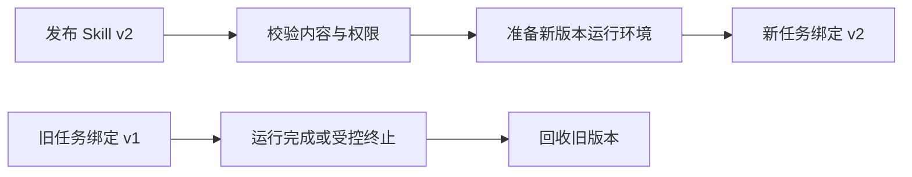

import InterviewQuestion from '../../../../components/InterviewQuestion.astro';

<InterviewQuestion>

热插拔是系统运行时发现、启用或替换能力。更新目录只是分发新内容，还要处理校验、运行资源、版本绑定和旧实例退出。正在执行的任务通常应继续使用原版本，新任务再采用新版本，避免说明、参数和脚本互不匹配。

## 用最简单的隔离满足实际需要

仅有 Markdown 与参考文件时，可以用不可变版本目录和原子切换的索引。包含代码、不同依赖或可能崩溃的脚本时，再考虑独立进程或容器；进程池和 RPC 会增加调度、序列化及运维成本，不是所有 Skill 都需要。

注册记录可以保存能力名、版本、输入输出契约和资源位置。任务记录保存实际采用的版本。对象存储可以分发内容，但不会自动解决进程切换、权限检查或在途调用兼容。

### 下架一个危险版本怎么办？

普通更新可等待旧任务完成；安全撤销则可能要立即阻止新动作并终止相关任务。保留已执行事实和明确的失败状态，不让恢复程序再次加载已撤销版本。回滚也应检查状态及数据格式是否兼容。

资料

核对于 2026-10-14。[Agent Skills 格式规范](https://github.com/agentskills/agentskills/blob/main/docs/specification.mdx)。规范定义内容结构，不承诺热更新；版本绑定、回收和撤销流程是本站对面经场景的工程方案。

</InterviewQuestion>
