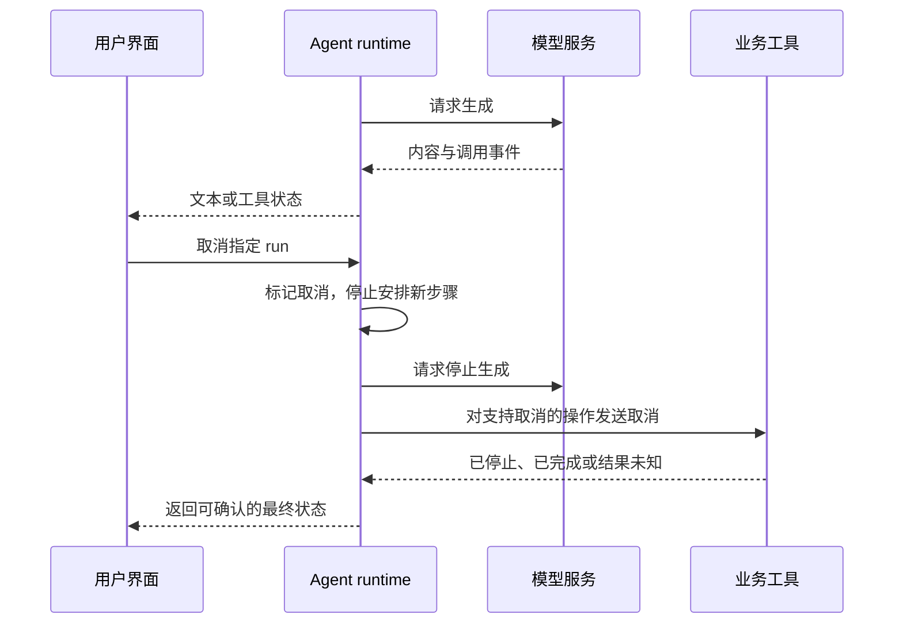

import InterviewQuestion from '../../../../components/InterviewQuestion.astro';

<InterviewQuestion>

流式输出把生成中的内容逐段交给用户，能让用户早看到进展。它不自动缩短整个任务耗时，也不意味着关闭连接后，模型和工具就全部停止。

把一次执行分成有类型的事件，例如文本片段、工具开始、工具结束和任务结束。前端根据事件更新界面，不从“正在查询”这句话推断后端状态。工具参数要组装完整并校验后才能执行。

## 取消要穿过整条执行链

任务有独立 run_id，取消标记由服务端保存。运行器在模型调用前、工具执行前和回调处理时检查它；支持取消的依赖继续传递信号。不支持取消的写操作可能已经提交，不能回复“全部撤销”。

例如邮件已发送，取消 Agent 不会把邮件收回来。应保存发送结果，停止后续动作，并告诉用户已完成哪一步。超时且无法确认结果时，保留“结果未知”，再查询状态。

### 页面刷新后，怎么防止重复显示或重新执行？

事件带 run_id 和序号，前端可按序号去重；需要续接时，服务端保存可回放事件。重新订阅已有任务，和重新创建任务是两件事。事件去重也不能代替业务写入的幂等。

### 用户很慢地读取，服务端要一直堆事件吗？

限制缓冲区。文本可以按协议合并片段，重要状态要保留；慢客户端无法跟上时，断开并允许从保存的位置续接。不能为了维持连接无限占用内存。

资料

核对于 2026-10-15。[AgentScope 实时事件与取消](https://doc.agentscope.io/tutorial/task_realtime.html)、[Qwen-Agent 流式调用示例](https://github.com/QwenLM/Qwen-Agent)。run_id、回放和邮件取消语义为工程设计示例，不表示所有框架默认实现。

</InterviewQuestion>
