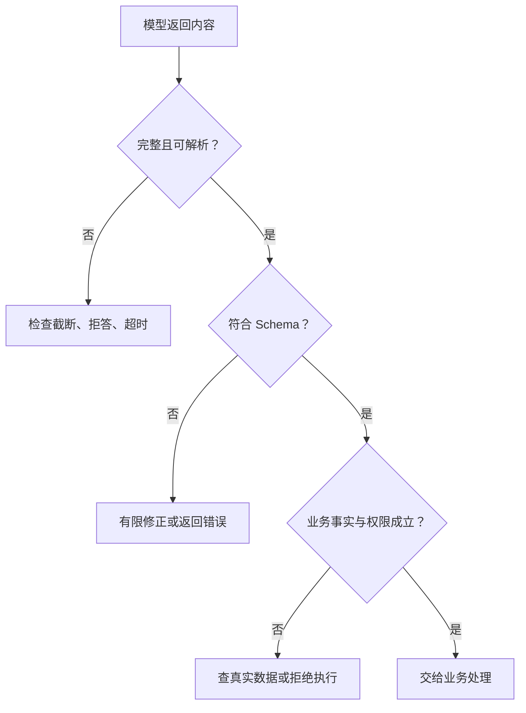

import InterviewQuestion from '../../../../components/InterviewQuestion.astro';

<InterviewQuestion>

提示词要求 JSON，只是要求模型按格式写。JSON 模式通常解决语法合法；Schema 模式进一步限制字段、类型和枚举。它们都不能保证内容是真的，例如合法的 order_id 仍可能是模型编的。

支持约束解码的实现会限制生成时可选的 Token，使输出符合指定语法或 Schema。可用的 Schema 子集、模型和模式都有支持范围，不能默认所有接口都一样。

## 允许“不知道”，才能少编字段

从邮件提取订单号时，字段设计应允许“未找到”，或返回明确的缺失状态。强制所有字段非空，却不给模型足够信息，会逼它填一个看起来合理的值。

字段名写清单位，枚举写清含义。收货地址、金额等重要内容还要与原文或业务系统核对。工具调用参数也经过同样检查，不能因为 Schema 通过就直接写数据库。

### 流式 JSON 到一半，能先执行了吗？

不应把半段参数当成最终调用。先按协议组装完整内容，确认结束状态，再解析和校验。文本流的一次 chunk 不一定对应一个完整字段。

### 解析失败，就把原文丢回模型重试吗？

先看是否达到输出上限、模型拒答或连接中断。确实是可修复的格式问题，再给精确错误并限制次数；持续失败就返回明确状态。无界重试只会增加开销，不能证明结果正确。

资料

核对于 2026-10-13。[百炼 JSON 与 JSON Schema 模式](https://help.aliyun.com/zh/model-studio/qwen-structured-output)、[阿里 DashInfer Guided Decoding](https://github.com/modelscope/dash-infer)。字段缺失与业务校验为工程示例。

</InterviewQuestion>
