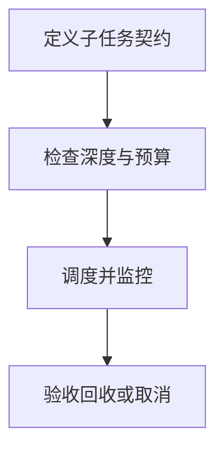

import InterviewQuestion from '../../../../components/InterviewQuestion.astro';

<InterviewQuestion>

子 Agent 要有明确任务、输入、产物和结束条件。父任务管理子任务状态、总预算和取消传播，限制深度、数量与并发；否则动态拆解可能不停创建新 Agent。

## 把任务树作为受控状态

创建前判断是否已有相同任务、是否构成循环依赖、预算是否足够。完成后验证产物再汇总，失败决定重试、替换或终止。子 Agent 申请新工作时由协调者审核边界，不能自行扩大权限。

### 父 Agent 已经结束，子 Agent 还在执行怎么办？

取消可停止的子任务，记录无法中止的操作并对账，禁止迟到结果更新新运行。最终状态说明未完成分支，进程退出不等于业务操作被撤销。

资料

核对于 2026-10-15。[LangChain 多 Agent 模式](https://docs.langchain.com/oss/python/langchain/multi-agent)。

</InterviewQuestion>
