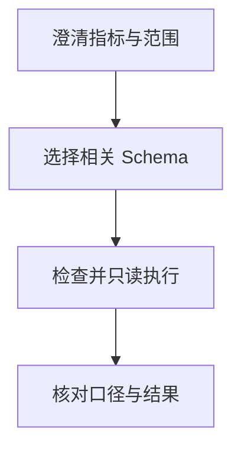

import InterviewQuestion from '../../../../components/InterviewQuestion.astro';

<InterviewQuestion>

先确认业务指标、时间、粒度和权限，再选择相关 Schema 与指标定义。模型生成 SQL 后由执行层检查结构、授权、成本和只读限制；语法可执行不代表业务口径正确。

## 把数据字典与执行代理分开

提供表关系、字段含义、时区、指标公式和示例，Schema 变更后刷新版本。执行层用 SQL 解析器限制语句、表、列和函数，并使用数据库最小权限账户及适用的只读事务；只检查以 `SELECT` 开头不够，查询仍可能调用有副作用的函数，或扫描过量数据。

租户及行级权限由可信身份绑定，不能让模型自行填写租户 ID 决定范围。再限制扫描量、返回行数和超时，对结果做范围、空值与总量核对。只读限制主要保护数据修改，不能自动防止越权读取和资源耗尽。

### 表结构变化导致线上失败怎样恢复？

检测 Schema 或执行错误，重新加载相关元数据后有限重试。口径不明时向用户澄清；不可在错误后改用高权限账户绕过限制。

资料

核对于 2026-10-15。[LangChain SQL Agent 的安全说明](https://docs.langchain.com/oss/python/langchain/sql-agent)、[PostgreSQL 行级安全](https://www.postgresql.org/docs/current/ddl-rowsecurity.html)。执行代理、限额与结果核对为工程建议，权限能力按实际数据库验证。

</InterviewQuestion>
