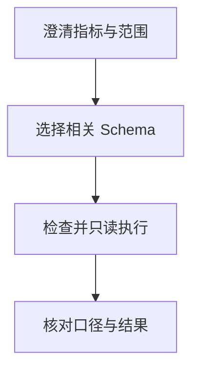

import InterviewQuestion from '../../../../components/InterviewQuestion.astro';

<InterviewQuestion>

先确认业务指标、时间、粒度和权限，再选择相关 Schema 与指标定义。模型生成 SQL 后由执行层检查结构、授权、成本和只读限制；语法可执行不代表业务口径正确。

## 把数据字典与执行代理分开

提供表关系、字段含义、时区、指标公式和示例，Schema 变更后刷新版本。使用 SQL 解析器及数据库最小权限账户，限制扫描量、返回行数和超时，避免单纯用字符串黑名单。对结果做范围、空值与总量核对。

### 表结构变化导致线上失败怎样恢复？

检测 Schema 或执行错误，重新加载相关元数据后有限重试。口径不明时向用户澄清；不可在错误后改用高权限账户绕过限制。

资料

核对于 2026-10-14。[Spring AI 工具调用](https://docs.spring.io/spring-ai/reference/api/tools.html)。正文场景、示例代码与方案取舍为教学示例；具体接口按选定版本核对。

</InterviewQuestion>
