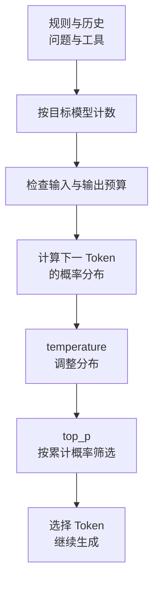

import InterviewQuestion from '../../../../components/InterviewQuestion.astro';

<InterviewQuestion>

Token 是模型处理文本的单位，不等于一个字或一个词。同一段文本换一个 tokenizer，数量可能不同。上下文窗口限制一次调用能容纳多少内容；temperature 和 top_p 影响从候选 Token 中怎样选下一个。

输入里除了用户问题，还有系统规则、历史消息、工具定义和工具结果。规划输入长度时，也要给输出及模型要求计入的推理 Token 留空间。各接口怎样计算这些限制，要查对应模型文档。

## 参数该怎么调

temperature 较低时，概率高的候选更占优势；较高时，候选更分散。top_p 根据累计概率限制候选范围。它们都影响采样，通常先固定一个，只调另一个，再用任务样本比较效果。

提取订单字段应优先用结构化输出和字段校验；文案生成可以允许更多变化。别把“低温”当成事实正确的保证：模型缺少订单信息，照样可能稳定地答错。

### temperature 设为 0，能保证每次一模一样吗？

不能据此承诺。模型版本、服务实现和数值计算也会影响结果。需要复现时，记录模型版本、完整输入、参数和实际输出；支持 seed 的接口也要看它承诺到什么程度。

### 上下文装不下，就删最老的消息吗？

要保留当前任务、约束、关键结果，以及配对的工具调用和返回。可以压缩旧对话、只检索相关记录，或缩短工具结果。单纯按时间截断，可能删掉用户刚确认的权限边界。

资料

核对于 2026-10-15。[AgentScope Token 计数](https://doc.agentscope.io/tutorial/task_token.html)、[Prompt Formatter](https://doc.agentscope.io/tutorial/task_prompt.html)、[百炼采样参数](https://help.aliyun.com/zh/model-studio/completions)。订单与预算处理为工程示例。

</InterviewQuestion>
