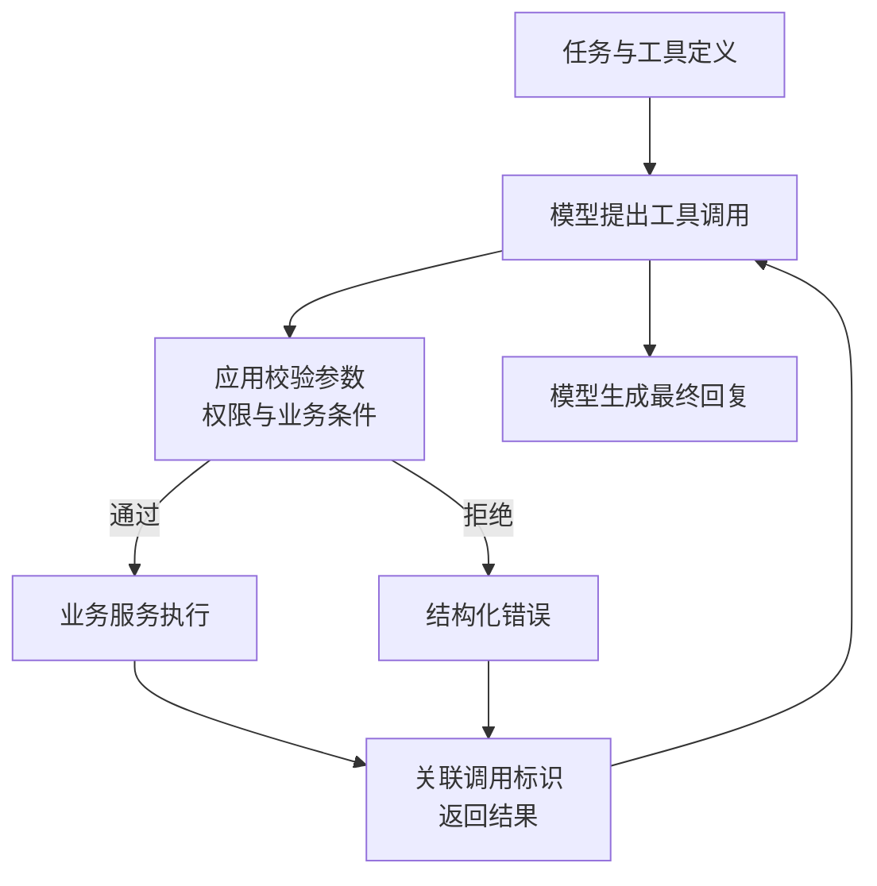

import InterviewQuestion from '../../../../components/InterviewQuestion.astro';

<InterviewQuestion>

模型返回工具名和参数，只表示它想调用工具，不表示操作已经完成。

对应用自定义工具，一次调用分为四步：把工具定义给模型；接收模型生成的调用；由应用校验并执行；把结果送回模型。模型再决定继续调用，还是回复用户。服务商托管工具可能由服务商执行，责任边界要另外确认。

## 参数正确，不代表有权执行

JSON Schema 能检查字段和类型，不能判断用户有没有权限。退款工具即使收到合法的订单号，也要从登录身份确认用户，读取真实订单，再检查归属、金额和订单状态。模型传入的 user_id 不能决定授权。

参数名要带上必要信息，例如 amount_cents 写明金额单位。返回结果也要说清成功、拒绝还是结果未知，别让模型从一大段日志里猜。

### 工具超时后可以直接重试吗？

读操作通常可以，但数据可能已经变化。写操作要谨慎：超时可能发生在退款成功之后。先查执行状态；如果接口支持幂等，再用同一个业务操作标识重试。每次重新生成标识，防不住重复退款。

### 工具报错要怎样处理？

参数错误可以修正；权限拒绝应停止；临时故障可以有限重试；结果未知则查状态或转人工。设置重试次数和总时长，别让模型一直循环。

资料

核对于 2026-10-13。[阿里 AgentScope Tool](https://doc.agentscope.io/tutorial/task_tool.html)、[Qwen-Agent 自定义工具](https://github.com/QwenLM/Qwen-Agent)。调用协议见 [Tool use overview](https://platform.claude.com/docs/en/agents-and-tools/tool-use/overview)，工具描述见 [Writing tools for agents](https://www.anthropic.com/engineering/writing-tools-for-agents)。退款场景与校验顺序为工程示例。延伸阅读：[生产 Agent 的工具设计](/ai/production-agent-tool-design/)。

</InterviewQuestion>
