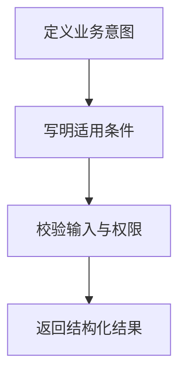

import InterviewQuestion from '../../../../components/InterviewQuestion.astro';

<InterviewQuestion>

工具应对应清晰的业务意图，说明什么时候使用、必需输入、返回含义和副作用。只有接口名和参数类型，模型很难判断适用条件；把所有业务放进一个万能工具也会让校验与调试变难。

## 让工具输出可继续行动

“查询订单”和“提交退款”分开，并写明金额单位、订单状态约束与权限要求。返回结构包含状态、数据、可重试性和操作标识，不把业务失败伪装成成功文本。细粒度工具便于组合，但过细会增加调用轮数。

### 工具越多、描述越详细越好吗？

过多描述消耗上下文并增加选择混淆。对易混工具给边界示例，通过误选率与任务成功率验证描述变更，不能只观察模型能否生成合法 JSON。

资料

核对于 2026-10-14。[Spring AI 工具调用](https://docs.spring.io/spring-ai/reference/api/tools.html)。正文场景、示例代码与方案取舍为教学示例；具体接口按选定版本核对。

</InterviewQuestion>
