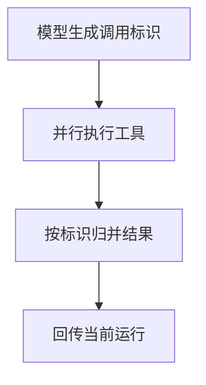

import InterviewQuestion from '../../../../components/InterviewQuestion.astro';

<InterviewQuestion>

工具结果要关联模型发出的调用标识，才能区分同一轮的多个调用。工具名相同也可能参数不同；只按消息到达顺序拼接，会把结果绑定到错误请求。

## 保留调用与结果的完整配对

记录调用 ID、工具版本、参数、执行状态和结果。并行结果按标识归并，并遵循所用模型接口对消息顺序的要求。失败也返回对应标识的结构化错误；对模型生成的标识校验唯一性，不能用它直接替代业务幂等键。

### 重复或迟到的结果怎么办？

先判断调用是否属于当前运行和尝试，按执行记录去重。运行已经取消或切换版本时，迟到结果可以入审计，但不能更新新的任务状态。

资料

核对于 2026-10-14。[Spring AI 工具调用](https://docs.spring.io/spring-ai/reference/api/tools.html)、[MCP Tools 2025-11-25](https://modelcontextprotocol.io/specification/2025-11-25/server/tools)。正文场景、示例代码与方案取舍为教学示例；具体接口按选定版本核对。

</InterviewQuestion>
